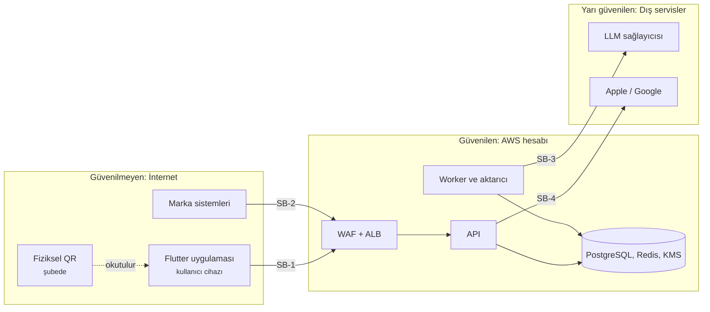

# Geri Bildirim ve Sadakat Motoru – Tehdit Modeli

9 Ekim 2026 · Murat Çay

## 1. Amaç ve Yöntem

Bu doküman, sistemin güvenlik kararlarının hangi tehditlere karşı alındığını ve hangi risklerin bilinçli olarak kabul edildiğini gösterir. Yöntem STRIDE'dır: her güven sınırı için kimlik sahteciliği (Spoofing), kurcalama (Tampering), inkar (Repudiation), bilgi ifşası (Information disclosure), hizmet engelleme (Denial of service) ve yetki yükseltme (Elevation of privilege) tehditleri incelenmiştir.

| Alan | Değer |
| --- | --- |
| Sürüm | 1.1 |
| Kapsam | Backend, mobil istemciyle ve marka sistemleriyle olan arayüzleri, dış servis bağımlılıkları |
| Kapsam dışı | Flutter uygulamasının iç güvenliği (mobil ekibin sorumluluğu), AWS'nin kendi altyapı güvenliği |
| Dayandığı dokümanlar | SRS v1.6, SDD v1.5 |
| Gözden geçirme | Her mimari değişiklikte ve en az üç ayda bir |
| Değişiklik (1.1) | T-T6: 24 saat kuralının şemaya aykırı LLM yanıtıyla kötüye kullanılması; T-D4: güven seviyesi MVP'de sonradan yükseltilmez (SRS CR-007) |

## 2. Korunan Varlıklar

| Varlık | Neden değerli | Kimin için |
| --- | --- | --- |
| Cüzdanlar ve puanlar | İleride ödüle dönüşecek; parasal değere eşdeğer | Kullanıcı, platform |
| Markaya sunulan veri | Ürünün satılan değeri; kirlenirse ürün değersizleşir | Marka, platform |
| Ham yorum metni | Kişisel veri içerebilir (isim, plaka, telefon) | Kullanıcı (KVKK) |
| Markalar arası veri ayrımı | Rakip markanın şikayet verisi ticari sırdır | Marka |
| Kimlik anahtarları ve imza anahtarları | Ele geçirilirse kimlik taklidi mümkün olur | Platform |
| LLM bütçesi | Tükenirse analiz durur | Platform |

## 3. Güven Sınırları

| Sınır | Açıklama | Temel varsayım |
| --- | --- | --- |
| SB-1 | Mobil uygulama → API | Cihaz ve uygulama saldırganın kontrolünde olabilir; istemciden gelen hiçbir beyana güvenilmez |
| SB-2 | Marka sistemleri → API | Marka kimlik bilgileri sızabilir; bir marka diğerinin verisini görmeye çalışabilir |
| SB-3 | Worker → LLM sağlayıcısı | Sağlayıcıya giden veri kurum dışına çıkar; dönen yanıt kullanıcı metninden etkilenebilir |
| SB-4 | API → Apple / Google | Platform kararları güvenilir kabul edilir; servisler kesintiye uğrayabilir |
| Fiziksel | QR → kullanıcı | Şubedeki QR fotoğraflanabilir veya üstüne sahtesi yapıştırılabilir |

## 4. Tehditler ve Önlemler

Risk = olasılık × etki (Y = yüksek, O = orta, D = düşük); önlemlerden **sonra** kalan risk verilmiştir.

### 4.1 Kimlik Sahteciliği (S)

| ID | Tehdit | Önlem | Kalan risk | Referans |
| --- | --- | --- | --- | --- |
| T-S1 | Script'in sahte cihaz kimlikleriyle sınırsız hesap açıp ödül toplaması | Platform tarafından doğrulanmış donanım anahtarı; doğrulanamayan cihaz ödül kazanamaz | D: gerçek cihaz çiftlikleri hâlâ mümkün, ancak cihaz başına maliyet yüksek | ADR-012, FR-AUTH-01, FR-AUTH-06 |
| T-S2 | Başka bir kullanıcının hesabına girme | Kimlik dışarı aktarılamayan anahtarda; ağda tekrar kullanılabilir sır yok | D | FR-AUTH-03 |
| T-S3 | Çalınan erişim token'ıyla ödül toplama | Token 15 dakika; ödül kazandıran istek gövdeye bağlı platform kanıtı gerektirir | D | FR-QR-10 |
| T-S4 | Kayıt veya oturum isteğinin tekrar gönderilmesi (replay) | Tek kullanımlık, 60 saniyelik nonce; iOS sayaç kontrolü | D | SDD 7.1 |
| T-S5 | Değiştirilmiş (repackaged) uygulamayla istek gönderme | App Attest uygulama kimliği; Android'de paket adı ve imza sertifikası kontrolü | D | SDD 7.1 |
| T-S6 | Marka istemci sırrının sızması | 15 dakikalık token; birden çok istemciyle kesintisiz rotasyon; kapsam sınırlaması; denetim kaydı | O: sızıntı fark edilene kadar o markanın verisi okunabilir | ADR-013, FR-B2B-09 |
| T-S7 | Tahmin edilerek sahte QR token'ı üretme | 128 bit rastgele token; bilinmeyen token reddedilir | D | FR-QR-01, ADR-010 |

### 4.2 Kurcalama (T)

| ID | Tehdit | Önlem | Kalan risk | Referans |
| --- | --- | --- | --- | --- |
| T-T1 | İstek gövdesinin yolda veya istemcide değiştirilmesi | TLS; platform kanıtı gövde özetine bağlı | D | NFR-SEC-01, FR-QR-10 |
| T-T2 | Prompt injection ile etiketin değiştirilmesi | Talimat–veri ayrımı; katı şema; ödül kararını kod verir; uzunluk ve deneme sınırları; değerlendirme setinde saldırı örnekleri | O: yeni injection teknikleri kısa süre etkili olabilir; insan örneklemesiyle yakalanır | SDD 8.2, NFR-AIQ |
| T-T3 | Ledger kayıtlarının değiştirilmesi veya silinmesi | Uygulama rolüne UPDATE/DELETE yetkisi yok; düzeltme yalnızca ters kayıtla | D | FR-GAM-03 |
| T-T4 | Şubedeki QR'ın üstüne sahte QR yapıştırılması (oltalama) | QR yalnızca platform alan adına bağlantı (alan adı: SRS S-21); uygulama başka alan adını reddeder; universal/app links; şube kontrol yönergesi | O: sistem kamerasıyla okutan kullanıcı sahte siteye gidebilir; kullanıcı bilinçlendirmesi gerekir | TZ-16 |
| T-T5 | QR fotoğrafının yayılmasıyla şube verisinin kirletilmesi | Kullanıcı başına şube kuralları; anomali tespiti; QR iptali | O: tespit edilene kadar veri kirlenir; kalıcı çözüm müşteri kararı | CR-001, TZ-2 |
| T-T6 | LLM yanıtını sürekli şemaya aykırı hale getiren bir yorumla (ör. prompt injection) analizi 24 saat boyunca engelleyip otomatik ödül alınması | Otomatik ödül yalnızca sağlayıcıya erişilemediğinde; son hata şemaya aykırı yanıtsa yorum ödülsüz kapatılır; deneme sınırı ve uzunluk sınırı | D | FR-AI-09, SDD 8.2 |

### 4.3 İnkar (R)

| ID | Tehdit | Önlem | Kalan risk | Referans |
| --- | --- | --- | --- | --- |
| T-R1 | Kullanıcının "ödülümü almadım" itirazı | Ledger ve yorum durumu geçmişi; correlation ID ile uçtan uca iz | D | FR-GAM-03, NFR-OBS-01 |
| T-R2 | Markanın veri erişimini inkar etmesi veya sızıntının kaynağının bulunamaması | B2B denetim kaydı: istemci, uç nokta, zaman, kayıt sayısı | D | FR-B2B-09 |
| T-R3 | AI kararının sorgulanması | Her analizde model, prompt sürümü ve etiket sürümü kaydı | D | FR-AI-11 |

### 4.4 Bilgi İfşası (I)

| ID | Tehdit | Önlem | Kalan risk | Referans |
| --- | --- | --- | --- | --- |
| T-I1 | Markanın başka markanın verisini görmesi | Marka kimliği yalnızca token'dan; zorunlu `BrandId` parametresi; 404; izolasyon testleri | D | TZ-9, FR-B2B-08 |
| T-I2 | Kişisel verinin LLM sağlayıcısına gitmesi | Desen tabanlı maskeleme | O: isimler kaçabilir (TZ-8); hukuki dayanak S-13 | FR-AI-07 |
| T-I3 | Ham metnin veritabanı veya yedek sızıntısıyla açığa çıkması | Zarf şifreleme; çözme yetkisi yalnızca worker rolünde | D | NFR-PRIV-02 |
| T-I4 | Logların kişisel veri veya yorum metni içermesi | Log redaction; metin loglanmaz; testle doğrulanır | D | NFR-OBS-01 |
| T-I5 | Çalışan isimlerinin markaya iletilmesi | B2B yalnızca maskelenmiş metni döner | O: maskelemenin kaçırdığı isim markaya gidebilir | FR-B2B-07, TZ-8 |
| T-I6 | Başka kullanıcının yorum durumunu sorgulama (IDOR) | Sahiplik kontrolü; başkasının yorumu için 404 | D | SDD 7.5 |
| T-I7 | Hata mesajlarının iç yapıyı sızdırması | Standart Problem Details yanıtı; yığın izi yalnızca loglarda | D | NFR-SEC-05 |

### 4.5 Hizmet Engelleme (D)

| ID | Tehdit | Önlem | Kalan risk | Referans |
| --- | --- | --- | --- | --- |
| T-D1 | Uzun metinlerle LLM bütçesinin tüketilmesi | 1.000 karakter ve 8 KB sınırı; ön kontroller; deneme sınırı; bütçe koruması | D | FR-AI-01, FR-AI-12 |
| T-D2 | API'nin istek yağmuruna tutulması | WAF; kimliğe bağlı hız sınırı; otomatik ölçekleme | O: büyük dağıtık saldırılarda ek koruma (AWS Shield Advanced) gerekebilir | FR-QR-06, SDD 9.1 |
| T-D3 | Kuyruğun doldurulması | Yalnızca kabul edilen yorumlar kuyruğa girer; kabul kuralları kimliğe bağlı | D | SDD 6.4 |
| T-D4 | Apple/Google doğrulama servislerinin kesintisi | Doğrulanamayan kayıt reddedilmez, düşük güven modunda açılır | O: kesinti süresince kayıt olan kullanıcılar düşük güvende kalır ve ödül kazanamaz; MVP'de güven seviyesi sonradan yükseltilmez, yeniden doğrulama sonraki fazdadır (SRS CR-007) | FR-AUTH-06 |
| T-D5 | LLM sağlayıcısının kesintisi | Yeniden deneme, devre kesici; yorum kaybolmaz; 24 saat kuralı | D | FR-AI-05, FR-AI-09 |
| T-D6 | Gerçek kullanıcıların ortak IP nedeniyle engellenmesi | Hız sınırı IP'ye değil kimliğe bağlı; WAF IP kuralları yalnızca geniş eşikli | D | FR-QR-06 |

### 4.6 Yetki Yükseltme (E)

| ID | Tehdit | Önlem | Kalan risk | Referans |
| --- | --- | --- | --- | --- |
| T-E1 | Düşük güven modundaki hesabın normal moda geçmeye çalışması | Güven seviyesi yalnızca sunucu tarafında, doğrulama sonucuyla belirlenir | D | FR-AUTH-06 |
| T-E2 | B2B istemcisinin kapsamı dışındaki uçlara erişmesi | Uç nokta bazlı kapsam kontrolü | D | ADR-013 |
| T-E3 | Geliştirme doğrulayıcısının üretimde açılması | Üretimde yapılandırmayla açılamaz; açılırsa uygulama başlamaz; testle doğrulanır | D | SDD 7.1 |
| T-E4 | Yönetim işlemlerine yetkisiz erişim | MVP'de yönetim uç noktası yok; seed script yalnızca yetkili IAM rolüyle çalışır | D | V-4 |
| T-E5 | CI/CD üzerinden altyapıya erişim | OIDC ile kısa ömürlü kimlik; üretim dağıtımı onaya bağlı | D | SDD 9.3 |

## 5. Kabul Edilen Kalan Riskler

Aşağıdaki riskler önlemlere rağmen orta seviyede kalır ve müşteriye açıkça bildirilmelidir:

| Risk | Neden kabul ediliyor | Takip |
| --- | --- | --- |
| Gerçek cihaz çiftlikleri (T-S1) | Anonimlik ile sahte hesaba direnç arasındaki temel denge; tamamen önlemek kimlik doğrulaması gerektirir | Risk sinyalleri; telefon doğrulaması sonraki faz |
| QR yayılmasıyla veri kirlenmesi (T-T5) | Kalıcı çözüm donanım veya kasa entegrasyonu gerektirir | CR-001 müşteri kararı |
| Sahte QR ile oltalama (T-T4) | Fiziksel ortam sistemin kontrolünde değil | Şube yönergesi, kullanıcı bilinçlendirmesi |
| İsimlerin maskelemeden kaçması (T-I2, T-I5) | Türkçe isim tanıma MVP kapsamı dışında | NER modeli sonraki faz; ham metin yeniden işlenebilir |
| Yeni prompt injection teknikleri (T-T2) | LLM'lerin doğası gereği tamamen önlenemez | Değerlendirme seti ve insan örneklemesi |
| B2B sırrının sızması (T-S6) | Markanın kendi sistemlerinin güvenliğine bağlı | Denetim kaydı, hızlı iptal |
