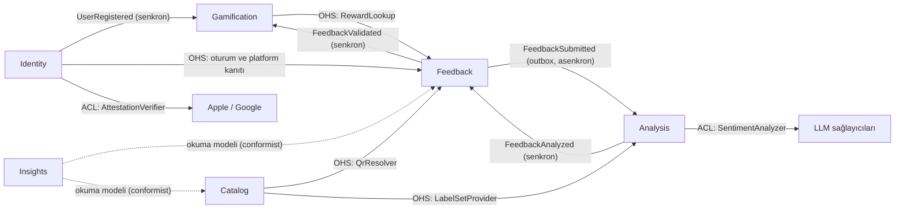

# Geri Bildirim ve Sadakat Motoru – Alan Modeli (DDD)

11 Ekim 2026 · Murat Çay

## 1. Amaç

Bu doküman, SDD'deki mimariyi Domain-Driven Design ile kodlanabilir hale getirir: sistemin hangi bounded context'lere bölündüğünü, bu context'lerin birbiriyle nasıl konuştuğunu, ortak dili (ubiquitous language) ve her context'in aggregate'lerini, kurallarını, olaylarını ve port'larını tanımlar. Kodun nasıl yazılacağına dair kurallar Mühendislik Standartları dokümanındadır (`07`).

| Alan | Değer |
| --- | --- |
| Sürüm | 1.2 |
| Dayandığı dokümanlar | SRS v1.6, SDD v1.3, API sözleşmesi 0.2.6-demo |
| Değişiklik (1.2) | 24 saat kuralı: yorum her durumda `unanalyzed` olarak kapatılır ve kilit açılır; ödül yalnızca uygunsa, bütçe koruması kapalıysa ve son hata sağlayıcıya erişilememesiyse (SRS CR-007) |
| Değişiklik (1.1) | Olay tiplerinin yeri: domain/events/, public/ yalnızca yeniden dışa aktarır |

## 2. Bounded Context'ler

Sistem altı bounded context'ten ve bilinçli olarak küçük tutulan bir shared kernel'den oluşur. Her context kendi modülüdür (ADR-001); context'ler arasında yalnızca bu dokümanda tanımlanan yollarla iletişim kurulur.

| Context | Sorumluluk | Tür | Gerekçe |
| --- | --- | --- | --- |
| **Feedback** | Yorum kabulü, ödül hakkı kuralları, yorumun yaşam döngüsü | Core | Sahteciliğe dayanıklı geri bildirim toplamak ürünün farkı |
| **Analysis** | Ön kontrol, kişisel veri maskeleme, LLM ile etiketleme, analiz kalitesi | Core | Markaya satılan değerin kaynağı |
| **Gamification** | Cüzdan, ledger, XP, puan, seviye | Core | Kullanıcıyı geri getiren mekanizma |
| **Identity** | Cihaz anahtarı, anonim kullanıcı, güven seviyesi, oturum | Supporting | Kritik ama iş farkı yaratmaz; platform doğrulaması dış servislere dayanır |
| **Catalog** | Marka, şube, QR kodu, konu listeleri | Supporting | Referans verisi |
| **Insights** | B2B istemcileri, markaya yönelik okuma modelleri ve raporlar | Supporting | Diğer context'lerin verisini markaya sunar |

**Shared kernel** yalnızca şunları içerir: tipli kimlikler (`UserId`, `BrandId`, `BranchId`, `FeedbackId`), `Clock` port'u, `DomainEvent` ve `DomainError` temel tipleri, `Result` tipi ve `UnitOfWork` port'u. İş kuralı içeren hiçbir şey shared kernel'e konmaz.

## 3. Context Map

| İlişki | Desen | Açıklama |
| --- | --- | --- |
| Catalog → Feedback, Analysis | Open Host Service | Catalog, QR çözümleme ve etiket listesi için kararlı, dar bir arayüz yayınlar (`QrResolver`, `LabelSetProvider`). |
| Identity → Feedback | Open Host Service | Feedback, isteği yapan kullanıcıyı (`UserId`, `TrustLevel`) ve isteğin platform kanıtının geçerliliğini Identity'den alır (`PlatformProofVerifier`). |
| Gamification → Feedback | Open Host Service | Yorum durumu sorgusu, kazanılan ödülü ve seviye atlamayı `RewardLookup` üzerinden okur. |
| Feedback → Analysis | Domain olayı, asenkron | `FeedbackSubmitted` outbox üzerinden kuyruğa gider (ADR-005). Context'ler arasındaki tek asenkron sınır budur. |
| Analysis → Feedback → Gamification | Domain olayı, senkron | `FeedbackAnalyzed` ve `FeedbackValidated` aynı unit of work içinde işlenir; analiz sonucu ve ödül tek transaction'dır (ADR-014, ADR-020). |
| Identity → Gamification | Domain olayı, senkron | `UserRegistered` ile cüzdan, kullanıcıyla aynı transaction'da açılır (FR-AUTH-01). |
| Analysis → LLM, Identity → Apple/Google | Anti-Corruption Layer | Dış servislerin veri modelleri adapter'da domain tiplerine çevrilir; domain'e sızmaz. |
| Insights → Feedback, Catalog | Conformist okuma modeli | Raporlama, diğer context'lerin kalıcı verisini salt okunur sorgularla okur (ADR-003'teki bilinçli istisna). Yazma yapmaz; kendi okuma modeli tipleri vardır. |

## 4. Ortak Dil (Ubiquitous Language)

Kodda yalnızca İngilizce karşılıklar kullanılır ve eş anlamlı kelimelere izin verilmez (örneğin `Comment` ya da `Review` değil, her yerde `Feedback`).

| Türkçe | Kodda | Tanım |
| --- | --- | --- |
| Yorum | `Feedback` | Kullanıcının bir şube için QR ile gönderdiği serbest metin geri bildirim |
| Yorum metni | `FeedbackText` | NFC normalizasyonundan sonra 20–1.000 Unicode kod noktası uzunluğunda metin |
| Ham metin | `RawText` | Maskelenmemiş, şifreli saklanan yorum metni |
| Maskelenmiş metin | `MaskedText` | Kişisel verileri yer tutucularla değiştirilmiş metin |
| Yorum durumu | `FeedbackStatus` | `Analyzing`, `Valid`, `Spam`, `Unanalyzed` |
| Marka | `Brand` | Sisteme dahil kurumsal müşteri |
| Sektör | `Sector` | `Fuel` (akaryakıt), `Coffee` (kahve) |
| Şube | `Branch` | Markanın fiziksel noktası |
| QR kodu / QR token'ı | `QrCode` / `QrToken` | Şubeye bağlı, tahmin edilemez, iptal edilebilir kod |
| Kullanıcı | `User` | Anonim son kullanıcı |
| Cihaz anahtarı | `DeviceKey` | Cihazın güvenli donanımında üretilen, platform tarafından doğrulanan anahtar |
| Güven seviyesi | `TrustLevel` | `Normal` veya `Low` (düşük güven: ödül kazanamaz) |
| Challenge | `Challenge` / `Nonce` | Tek kullanımlık, 60 saniyelik değer |
| Platform kanıtı | `PlatformProof` | İstek gövdesine bağlı App Attest assertion veya Play Integrity token'ı |
| Oturum | `Session` | En fazla 15 dakikalık erişim token'ı |
| Ödül hakkı (kuralları) | `RewardCooldown` | Kullanıcı–şube çifti için bekleme süresi, deneme sınırı ve tek bekleyen yorum kuralları |
| Deneme | `Attempt` | Bir şubeye yapılan yorum gönderimi |
| Bekleyen yorum | `PendingFeedback` | Analizi sürdüğü için ödül hakkını tutan yorum |
| Analiz | `FeedbackAnalysis` | Bir yorumun etiketleme süreci ve sonucu |
| Duygu | `Sentiment` | `Happy`, `Satisfied`, `Neutral`, `Disappointed`, `Angry` |
| Konu | `Topic` / `TopicKey` | Sektöre ait sürümlü listedeki konu ve sabit anahtarı |
| Etiket seti | `LabelSet` | Bir sektörün belirli sürümdeki konu listesi |
| Spam | `Spam` / `SpamReason` | Anlamlı geri bildirim olmayan metin ve sebebi |
| Analiz edilemedi | `Unanalyzed` | 24 saatte analiz edilemeyip geçerli sayılan yorum |
| Cüzdan | `Wallet` | Kullanıcının XP, puan ve seviye özeti |
| Hareket kaydı | `LedgerEntry` | Yalnızca eklenebilen XP/puan değişikliği |
| Ödül | `Reward` | Geçerli yorum için verilen XP ve puan |
| İade | `Clawback` | Ödülü ters kayıtla geri alma |
| Seviye | `Level` | Toplam XP'den türetilen değer |
| Şikayet | `Complaint` | Duygusu `Disappointed` veya `Angry` olan geçerli yorum |
| B2B istemcisi | `B2bClient` | Markanın OAuth2 istemci kimliği |
| Kapsam | `Scope` | `b2b.feedback.read`, `b2b.summary.read` |
| Şube özeti / Isı haritası | `BranchSummary` / `Heatmap` | Markaya sunulan okuma modelleri |
| Zaman aralığı | `TimeRange` | Saat dilimine göre yorumlanan B2B tarih aralığı |

## 5. Context'lerin Taktik Tasarımı

Her context için: aggregate'ler ve korudukları kurallar (invariant), değer nesneleri, yayınladığı ve dinlediği olaylar, port'lar ve use case'ler. Driving port = dışarıdan çağrılan use case; driven port = context'in ihtiyaç duyduğu dış yetenek.

### 5.1 Identity

| Unsur | Tasarım |
| --- | --- |
| Aggregate | **User** (kök) ve ona ait **DeviceKey** entity'leri |
| Invariant'lar | Bir anahtar tek bir kullanıcıya aittir (FR-AUTH-02). İptal edilen anahtarla oturum açılamaz (FR-AUTH-07). iOS imza sayacı kesin artan olmalıdır. Güven seviyesi yalnızca doğrulama sonucuyla belirlenir; istemci değiştiremez (FR-AUTH-06). |
| Değer nesneleri | `KeyIdentifier`, `PublicKey`, `Platform`, `TrustLevel`, `SignCounter`, `Nonce` |
| Yayınlanan olaylar | `UserRegistered` |
| Driven port'lar | `UserRepository`, `ChallengeStore`, `AttestationVerifier` (ACL; iOS, Android, Dev), `AccessTokenIssuer`, `Clock` |
| Open host service | `PlatformProofVerifier`: bir isteğin platform kanıtını doğrular ve güven sonucunu döner (FR-QR-10) |
| Use case'ler | `CreateChallenge`, `RegisterDevice`, `CreateSession`, `AuthenticateRequest`, `RevokeDeviceKey` (yönetim) |

`Challenge` bir aggregate değildir; kısa ömürlü, tek kullanımlık bir değerdir ve `ChallengeStore` port'unda tutulur.

### 5.2 Catalog

| Unsur | Tasarım |
| --- | --- |
| Aggregate'ler | **Brand**; **Branch** (kök) ve ona ait **QrCode** entity'leri; **LabelSet** |
| Invariant'lar | QR token'ı en az 128 bit rastgelelikte ve tekildir; iptal edilen QR yeniden etkinleştirilemez, yerine yenisi üretilir (FR-QR-01). Yayınlanmış bir etiket seti değişmez; değişiklik yeni sürümdür. Her etiket setinde `other` konusu bulunur (TZ-12). |
| Değer nesneleri | `QrToken`, `Sector`, `GeoPoint`, `TopicKey`, `LabelSetVersion` |
| Yayınlanan olaylar | Yok (MVP) |
| Open host service | `QrResolver`: token'dan şube, marka ve sektörü çözer; bilinmeyen veya iptal edilmiş token için "yok" döner. `LabelSetProvider`: sektörün güncel etiket setini döner. |
| Use case'ler | `RevokeQrCode` (yönetim); tanımlar MVP'de yönetim script'iyle yapılır (V-4) |

### 5.3 Feedback

| Unsur | Tasarım |
| --- | --- |
| Aggregate'ler | **Feedback** (kök) ve ona ait **RawText**; **RewardCooldown** (kimliği: kullanıcı + şube) |
| Feedback invariant'ları | Metin `FeedbackText` kurallarına uyar (FR-AI-01). Durum yalnızca `Analyzing`'den bir kez değişir; analiz sonucu iki kez uygulanmaz. Ödüle uygunluk, gönderim anındaki güven seviyesi ve platform kanıtıyla belirlenir ve sonradan değişmez (FR-QR-10). Aynı kullanıcı ve Idempotency-Key ile tek yorum vardır; anahtar farklı bir gövdeyle gelirse reddedilir (FR-AI-10). |
| RewardCooldown invariant'ları | Aynı anda en fazla bir bekleyen yorum (FR-QR-07). Son ödüllü yorumun gönderiminden 24 saat geçmeden yeni yorum kabul edilmez (FR-QR-07). Herhangi bir 24 saatlik aralıkta en fazla 3 deneme (sliding log, FR-QR-09, ADR-016). Bekleyen yorumu yalnızca o yorumun sonucu serbest bırakabilir. |
| Değer nesneleri | `FeedbackText`, `RawText`, `MaskedText`, `IdempotencyKey`, `RequestFingerprint`, `FeedbackStatus`, `RejectionReason` (`FeedbackPending`, `RewardCooldown`, `AttemptsExhausted`; kalan süreyle) |
| Yayınlanan olaylar | `FeedbackSubmitted` (asenkron), `FeedbackValidated` (senkron) |
| Dinlenen olaylar | `FeedbackAnalyzed` |
| Driven port'lar | `FeedbackRepository`, `RewardCooldownRepository`, `RawTextCipher`, `QrResolver`, `PlatformProofVerifier`, `RewardLookup`, `Clock`, `IdGenerator` |
| Use case'ler | `SubmitFeedback`, `GetFeedbackStatus`, `ApplyAnalysisResult` (olay işleyicisi), `FinalizeUnanalyzedFeedback` (24 saat, FR-AI-09: her durumda `unanalyzed` olarak kapatır ve kilidi açar; ödül yalnızca gönderimde uygunsa ve bütçe koruması kapalıysa) |

**RewardCooldown'ın davranışı:**

| Metot | Ne yapar |
| --- | --- |
| `reserve(feedbackId, now)` | Üç kuralı kontrol eder; uygunsa denemeyi kaydedip yorumu bekleyen yapar; değilse sebebi ve kalan süreyi içeren bir `RejectionReason` döner |
| `complete(feedbackId, outcome, submittedAt)` | Bekleyen yorum bu yorumsa kilidi açar; sonuç ödüllüyse `lastRewardedAt = submittedAt` |

Eşzamanlı iki istek aynı satırı yüklerse ikisi de kuralı geçebilir; bunu domain değil repository çözer: kayıt iyimser kilitle (`version`) yapılır, ikinci yazma çakışma hatası alır, use case aggregate'i yeniden yükleyip kuralı tekrar uygular ve bu kez `FeedbackPending` döner (ADR-019).

### 5.4 Analysis

| Unsur | Tasarım |
| --- | --- |
| Aggregate | **FeedbackAnalysis** (kök; kimliği yorum kimliği) |
| Invariant'lar | Sonuç bir kez kaydedilir. Denemeler, yorumun gönderiminden itibaren 24 saat içinde yapılır (FR-AI-05). Konu anahtarı, şubenin sektörüne ait etiket setinde bulunmalıdır; bulunmuyorsa yanıt şemaya aykırı sayılır (FR-AI-03, FR-AI-04). Her sonuç model, prompt sürümü ve etiket seti sürümüyle kaydedilir (FR-AI-11). Başarısız denemenin türü kaydedilir: sağlayıcıya erişilemedi veya şemaya aykırı yanıt (FR-AI-09). |
| Domain servisleri | `PreChecks` (AI dışı ön kontroller), `PiiMasker` (SDD 8.6 kuralları), `RetryPolicy` (üstel bekleme, 24 saat sınırı), `BudgetPolicy` (%80 / %100 eşikleri, FR-AI-12) |
| Değer nesneleri | `MaskedText`, `Sentiment`, `TopicKey`, `SpamReason`, `AnalysisVerdict`, `LlmUsage`, `MicroUsd`, `PromptVersion` |
| Yayınlanan olaylar | `FeedbackAnalyzed` |
| Dinlenen olaylar | `FeedbackSubmitted` (kuyruk üzerinden) |
| Driven port'lar | `FeedbackAnalysisRepository`, `SentimentAnalyzer` (ACL; OpenAI, Anthropic, Fake), `RawTextSource` (Feedback'in sağladığı çözme yeteneği), `LabelSetProvider`, `LlmSpendLedger`, `JobQueue`, `Clock` |
| Use case'ler | `ProcessAnalysisJob` |

`ProcessAnalysisJob` sırası: ön kontrol → maskeleme → LLM çağrısı (transaction **dışında**) → şema ve etiket seti doğrulaması → unit of work içinde sonucu kaydet ve `FeedbackAnalyzed` yayınla. LLM hatasında iş `RetryPolicy`'ye göre yeniden planlanır.

### 5.5 Gamification

| Unsur | Tasarım |
| --- | --- |
| Aggregate | **Wallet** (kök; kimliği kullanıcı kimliği) |
| Invariant'lar | Bakiye yalnızca ledger kaydı eklenerek değişir; cüzdan bakiyesi her zaman kayıtların toplamına eşittir (NFR-DATA-01). Aynı `idempotencyKey` ile ikinci kayıt eklenmez (FR-GAM-04). Kayıtlar değiştirilmez; düzeltme ters kayıttır (FR-GAM-03, FR-GAM-07). Seviye, toplam XP'den `LevelPolicy` ile türetilir (FR-GAM-02). |
| Ledger'ın aggregate'teki yeri | `Wallet` tüm geçmişi belleğe yüklemez. Yeni kaydı üreten metot (`award`, `clawback`) kaydı ve bakiye değişikliğini birlikte döner; repository yalnızca yeni kaydı ekler ve cüzdanı iyimser kilitle günceller. Kayıt tekilliği veritabanı kısıtıyla da korunur (G-3). |
| Değer nesneleri | `Xp`, `Points`, `Level`, `LedgerEntryType` (`Reward`, `Clawback`), `LedgerIdempotencyKey` |
| Domain servisi | `LevelPolicy`: L seviyesi için toplam XP = 100 × L × (L − 1) / 2 |
| Dinlenen olaylar | `UserRegistered` (cüzdan aç), `FeedbackValidated` (ödüle uygunsa ödül ver) |
| Driven port'lar | `WalletRepository`, `Clock` |
| Open host service | `RewardLookup`: bir yorum için verilen ödülü ve seviye atlamayı döner |
| Use case'ler | `OpenWallet`, `AwardReward`, `ClawbackReward` (yönetim), `GetWallet` |

### 5.6 Insights

| Unsur | Tasarım |
| --- | --- |
| Aggregate | **B2bClient** |
| Invariant'lar | İptal edilmiş veya süresi dolmuş istemci token alamaz. İstenen kapsam, istemcinin kapsamlarının alt kümesi olmalıdır (FR-B2B-01). |
| Okuma modelleri | `BrandFeedbackView`, `BranchSummary`, `Heatmap`, `TopicList`. Okuma modelleri aggregate değildir; iş kuralı içermezler. |
| Kurallar | Her sorgu zorunlu bir `BrandId` ile çalışır; başka markanın kaynağı "bulunamadı" sayılır (FR-B2B-08). Şikayet tanımı (FR-B2B-04). Spam ve kullanıcı kimliği yanıtlara girmez (FR-B2B-06, FR-B2B-07). `TimeRange`, varsayılan Europe/Istanbul ile yorumlanır (FR-B2B-10). İmleç tabanlı sayfalama. |
| Değer nesneleri | `ClientId`, `SecretHash`, `Scope`, `TimeRange`, `Cursor`, `PageSize` |
| Driven port'lar | `B2bClientRepository`, `ReportingQueries` (salt okunur), `AuditLog`, `AccessTokenIssuer`, `Clock` |
| Use case'ler | `IssueB2bToken`, `ListBranches`, `ListBrandFeedbacks`, `GetBranchSummary`, `GetHeatmap`, `ListTopics` |

## 6. Domain Olayları

Yalnızca bir tüketicisi olan olaylar tanımlanır; kullanılmayan olay yazılmaz.

| Olay | Üreten | Tüketen | Teslim | Taşıdığı veri |
| --- | --- | --- | --- | --- |
| `UserRegistered` | Identity | Gamification | Senkron, aynı unit of work | `userId`, `occurredAt` |
| `FeedbackSubmitted` | Feedback | Analysis | Asenkron: outbox → kuyruk | `feedbackId`, `branchId`, `sector`, `submittedAt`, `correlationId` |
| `FeedbackAnalyzed` | Analysis | Feedback | Senkron, aynı unit of work | `feedbackId`, `verdict` (geçerli/spam), `maskedText`, `sentiment`, `topicKey`, `analyzedAt` |
| `FeedbackValidated` | Feedback | Gamification | Senkron, aynı unit of work | `feedbackId`, `userId`, `submittedAt`, `rewardEligible` |

**Kurallar:**

- Senkron olay işleyicileri, olayı üreten işlemle aynı unit of work içinde çalışır; biri hata verirse tamamı geri alınır (ADR-020).
- Bir iş akışında en fazla bir asenkron sınır vardır: `FeedbackSubmitted`. Asenkron olaylar yalnızca outbox üzerinden yayınlanır (ADR-005).
- Olaylar geçmiş zaman kipinde adlandırılır ve değişmez değer nesneleridir.
- Olay tipleri yayıncı context'in domain'inde tanımlanır (`src/contexts/<context>/domain/events/`); `<context>/public/` yalnızca tipi yeniden dışa aktarır (`export type { … }`). Tüketiciler olayı yalnızca yayıncının `public/` klasöründen içe aktarır, kendi kopyasını yazmaz. Olay dosyaları yalnızca shared kernel'i (tipli kimlikler, `DomainEvent`, `Date` ve ilkel tipler) kullanır; context'in kendi değer nesnelerini içe aktarmaz.
- `FinalizeUnanalyzedFeedback`, 24 saatin sonunda hâlâ `analyzing` olan yorumu `unanalyzed` olarak kapatır ve `FeedbackAnalyzed` yerine doğrudan `FeedbackValidated` üretir (FR-AI-09). Ödül yalnızca yorum gönderimde ödüle uygunsa, bütçe koruması devrede değilse ve son analiz hatası sağlayıcıya erişilememesiyse verilir (şemaya aykırı yanıtta ödül yok, Tehdit Modeli T-T6); aksi halde olay `rewardEligible: false` ile üretilir. Her iki durumda şubedeki kilit açılır. *(Ekip önerisi; müşteri doğrulaması bekliyor, SRS CR-007.)*

## 7. Transaction Sınırları

DDD'nin "bir transaction'da bir aggregate" ilkesinden iki bilinçli sapma vardır; ikisinin de gerekçesi tutarlılığın ödülle ilgili olmasıdır.

| İşlem | Değişen aggregate'ler | Neden tek transaction |
| --- | --- | --- |
| Kayıt (`RegisterDevice`) | User, Wallet | Cüzdansız kullanıcı oluşmamalı (FR-AUTH-01) |
| Yorum kabulü (`SubmitFeedback`) | Feedback (+RawText), RewardCooldown, outbox | Kilit alınmış ama yorumu olmayan ya da kuyruğa hiç gitmeyen yorum oluşmamalı (TZ-4) |
| Analiz sonucu (`ProcessAnalysisJob` → olaylar) | FeedbackAnalysis, Feedback, RewardCooldown, Wallet | Analiz kaydedilip ödülü verilmemiş yorum olmamalı (ADR-014) |

Aggregate'ler birbirini doğrudan çağırmaz; aynı transaction'a domain olaylarıyla katılırlar. Context'ler ileride ayrı süreçlere bölünürse senkron olaylar outbox'a taşınır ve bu sapmalar kalkar.
