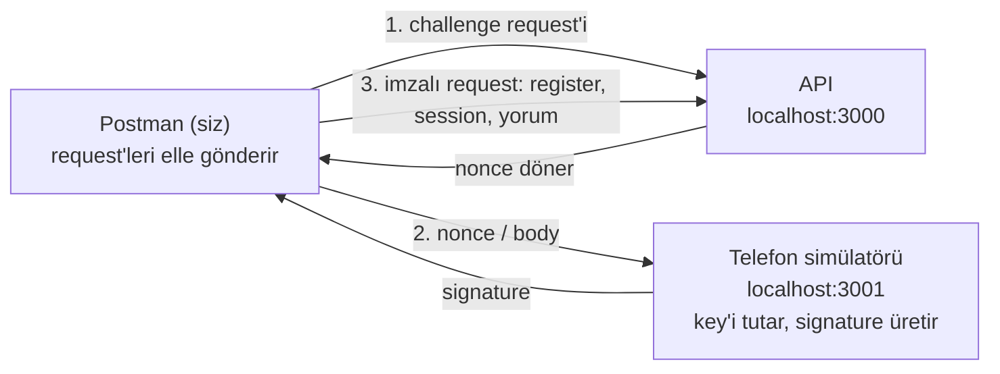

# Demo Rehberi: Geri Bildirim ve Sadakat Motoru

23 Ekim 2026 · Murat Çay

Mobil uygulama ve marka paneli henüz yazılmadı, ama backend çalışır durumda. Bu rehberdeki adımlarla projeyi kendi bilgisayarınızda ayağa kaldırabilir, mobil uygulamanın ve panelin göndereceği request'leri Postman'den kendiniz gönderip sistemin nasıl davrandığını görebilirsiniz.

## Nasıl çalışır

Denemeler sırasında üç şey aynı anda açık olacak:

- **API:** Projenin kendisi, `http://localhost:3000` adresinde çalışır. Demo modunda veriler memory'de tutulur; uygulamayı kapattığınızda her şey sıfırlanır.
- **Telefon simülatörü:** Gerçek bir telefonda device key'i ve signature'ları telefonun secure chip'i (iOS'ta Secure Enclave, Android'de Keystore) üretir. Bunları elle yazmak mümkün olmadığı için projeye küçük bir simülatör ekledim; `http://localhost:3001` adresinde çalışır. Simülatör API'ye kendisi request atmaz. Ürettiği değerleri size verir, siz de request'e eklersiniz.
- **Postman:** Request'leri gönderdiğiniz yer. Request'ler API contract'ından (`docs/api/openapi.yaml`) gelir; mobil ekip ve panel de aynı contract'a göre çalışacak.

Akış her seferinde aşağı yukarı aynı: API'den tek kullanımlık bir nonce alırsınız, simülatöre imzalatırsınız, imzalı request'i API'ye gönderirsiniz.



Simülatör API'ye hiç bağlanmaz; ürettiği değerleri yalnızca size verir.

### Demo verisi

Uygulama iki hayali marka ve toplam 10 şubeyle açılır. Her şubenin bir QR kodu var; QR token bu kodun içindeki değer. Değerler sabit, uygulamayı her açtığınızda aynı kalır.

**Örnek Petrol**

- Kadıköy Rıhtım: `JhVmZFbSHE3HvttMmV3z7w`
- Maslak: `Hzq6bpcvWP5Aw885G08JSw`
- Eskişehir Yolu: `RcF9YyH3Th6nlKBxmVtiwQ`
- Kızılay: `vRb9el3eGOKUYHlwNyYZEQ`
- Bornova: `NfDwlBmUgoeoe9d1T2N_RA`

**Örnek Kahve**

- Beşiktaş Çarşı: `ETmkRP68q8g-ZQAmZyLYsg`
- Moda: `E6p_JmfY102iydoSNxBETA`
- Tunalı Hilmi: `UyK93XE4tK8HEdDbPUz6Ng`
- Alsancak: `jpDYSqC8aWxjjfZIhtr1iA`
- Karşıyaka Çarşı: `TJkYHpepksiu07012xPFKQ`

Senaryolar bu şubeleri belli bir sırayla kullanıyor. Bunun sebebi bazı kuralların şube bazında işlemesi: örneğin bir şubeden ödül alan kullanıcı, aynı şubeden 24 saat boyunca tekrar ödül alamaz. Senaryoları sırasıyla yaparsanız birbirine karışmaz.

## Kurulum

Bu bölüm yalnızca ilk seferde yapılır. Bilgisayarınızda Git, Node.js 22 ve Postman'in desktop uygulaması olması yeterli; Docker, database ya da Redis kurmanıza gerek yok. Komutlar macOS ve Linux'a göre yazıldı, Windows'ta WSL içinde aynen çalışır.

### 1. Node.js 22

Proje Node.js 22 ile çalışıyor; farklı bir versiyonda `npm ci` hata verir. Versiyonlar arasında rahat geçmek için nvm öneririm:

1. nvm yüklü değilse [nvm'in GitHub sayfasındaki](https://github.com/nvm-sh/nvm) install komutunu çalıştırın, ardından terminali kapatıp yeniden açın.
2. `nvm install 22`
3. `node -v` komutu `v22` ile başlayan bir versiyon göstermeli.

Repo'da `.nvmrc` dosyası olduğu için sonraki seferlerde proje klasöründe `nvm use` yazmak yeterli.

### 2. Repo'yu clone'lama

```
git clone https://github.com/dev-murchi/gemified-feedback-loyalty-project-demo.git
cd gemified-feedback-loyalty-project-demo
git switch demo
npm ci
```

`npm ci` dependency'leri yükler, bir iki dakika sürebilir. Output'un sonunda `ERR!` ile başlayan bir satır görmemeniz gerekiyor. README'deki "Before start:demo" bölümü güncel değil; oradaki export adımını uygulamayın, bu rehberi takip edin.

### 3. Postman'e API'yi import etme

1. Postman'de sol üstteki **Import** butonuna tıklayın.
2. Proje klasöründen `docs/api/openapi.yaml` dosyasını seçin. "Import as" sorulursa **Postman Collection**'ı seçin.
3. Sol tarafta "Geri Bildirim ve Sadakat Motoru API" adında bir collection oluşur. Request'ler Kimlik, Cüzdan, Yorum ve B2B klasörlerine ayrılmış olarak gelir.
4. Collection'ın adına tıklayıp **Variables** tab'ını açın. `baseUrl` değeri `http://localhost:3000` olmalı. Buraya iki boş variable daha ekleyin: mobil kullanıcının token'ı için `accessToken`, markanın token'ı için `b2bToken`. Ardından kaydedin (Cmd/Ctrl + S).
5. Yine collection'da **Authorization** tab'ını açın. Type olarak **Bearer Token** seçip Token alanına `{{accessToken}}` yazın ve kaydedin. Böylece mobil request'ler token'ı her seferinde buradan alır.
6. B2B klasöründe, token alma request'i (`POST /v1/b2b/oauth/token`) dışındaki bütün request'lerin Authorization tab'ında Type: **Bearer Token**, Token: `{{b2bToken}}` yapın. Token alma request'ini **No Auth** olarak bırakın.

**Önemli:** Postman contract'ı import ederken GET request'lerine optional query parametrelerini de ekliyor (`cursor=<string>`, `limit=<integer>` gibi) ve checkbox'larını işaretli bırakıyor. Bu hâliyle gönderirseniz API `400 VALIDATION_ERROR` döner. Her GET request'inde **Params** tab'ına girip bu checkbox'ları kaldırın; sadece denemek istediğiniz filtreyi gerçek bir değerle açın.

### 4. Postman'e simülatörü ekleme

Simülatör contract'ta olmadığı için ona ayrı bir collection açın (New → Collection, adı "Telefon simülatörü" olabilir) ve içine şu üç request'i ekleyin:

1. **QR listesi:** `GET http://localhost:3001/qr`
2. **Telefon:** `GET http://localhost:3001/devices?platform=ios&nonce=`
3. **Yorum imzası:** `POST http://localhost:3001/devices/:deviceId/feedback`, Body → raw → JSON

Bu collection'da Authorization **No Auth** olarak kalmalı.

## Uygulamayı başlatma

Her denemeden önce iki terminal tab'ı açıp birinde API'yi, diğerinde simülatörü çalıştırın. İkisi de denemeler bitene kadar açık kalmalı.

**1. tab, API:**

```
cd gemified-feedback-loyalty-project-demo
nvm use
npm run start:demo
```

Proje başlamadan önce build edildiği için ilk seferde bir dakika kadar sürebilir. Demo ayarları `scripts/demo-sim/demo.env` dosyasından okunur: port 3000, demo verisi açık, gerçek LLM yerine fake analyzer. Log'larda fake analyzer ile ilgili bir warning göreceksiniz, bu normal.

**2. tab, simülatör:**

```
cd gemified-feedback-loyalty-project-demo
nvm use
npm run demo-sim
```

Ekranda `Demo simulator: http://localhost:3001` yazısı çıkmalı. Simülatör aynı ağdaki diğer cihazlardan da erişilebilir durumda; ortak bir Wi-Fi'deyseniz işiniz bitince kapatın.

**Her şey hazır mı?** Simülatör collection'ındaki **QR listesi** request'ini gönderin. 10 şubenin adı, markası ve QR token'ı geliyorsa başlayabilirsiniz.

**Restart ederseniz:** API'yi durdurup (1. tab'da Ctrl + C) tekrar `npm run start:demo` ile açtığınızda bütün kullanıcılar, yorumlar ve token'lar silinir. Bu durumda senaryolara en baştan, kayıttan başlamanız gerekir.

### Gerçek LLM ile denemek (opsiyonel)

Fake analyzer her yorumu "geçerli, nötr, konu: Diğer" diye işaretler. Yorumların gerçekten duygu ve konuya göre ayrıldığını görmek isterseniz bir OpenAI API key'i gerekiyor. 1. tab'da `npm run start:demo`'dan önce şunları yazın:

```
export LLM_DRIVER=openai
export OPENAI_API_KEY=<API key'iniz>
export OPENAI_MODEL=<model adı>
```

Terminalde export ettiğiniz environment variable'lar `demo.env`'deki değerleri override eder. Key'i dosyaya yazmayın. Terminal penceresini kapatırsanız bu satırları tekrar yazmanız gerekir.

## Birkaç terim

Senaryolarda sık karşılaşacağınız kavramlar:

- **Nonce (challenge):** API'nin ürettiği, 60 saniye geçerli ve bir kez kullanılabilen değer. Telefon bunu imzalayarak private key'in kendisinde olduğunu kanıtlar.
- **Signature (imza):** Telefonun secure chip'indeki private key ile üretilen değer. Key chip'ten hiç çıkmaz; server sadece signature'ın doğru olup olmadığına bakar.
- **Access token:** Register ya da session sonrasında verilen token. 15 dakika geçerli; request'ler bunu `Authorization: Bearer ...` header'ında taşır.
- **QR token:** Şubedeki QR kodunun içindeki değer. Yorumun hangi şubeye yazıldığını bununla anlarız.
- **Idempotency-Key:** Her yeni yorum için üretilen unique key. Bağlantı koptuğu için aynı request ikinci kez gelirse server yeni bir yorum açmaz, ilk seferki response'u tekrar döner.
- **X-Platform-Proof:** Yorumun signature'ı. Body'nin her byte'ına bağlıdır; tek bir boşluk bile değişse signature tutmaz ve yorum ödülsüz kaydedilir.
- **B2B:** Markaların kendi verilerine ulaştığı taraf, yani markanın paneli ya da sistemi. Mobil kullanıcılardan ayrı bir token ile çalışır.

Error response'larında mutlaka bir `code` field'ı olur (`QR_INVALID`, `REWARD_COOLDOWN` gibi). Mobil uygulama kullanıcıya hangi mesajı göstereceğine bu koda bakarak karar verir. Kodların tamamı `docs/api/openapi.yaml` dosyasının başındaki "Hata kataloğu" bölümünde.

## Kullanıcı tarafı: register ve session

Kullanıcı uygulamayı ilk açtığında form doldurmaz; adı, telefonu ya da e-postası sorulmaz. Kimliği, telefonunun secure chip'indeki key'dir.

Senaryolar sırayla yapılmak üzere numaralandı, çünkü çoğu bir önceki adımda çıkan değeri kullanıyor. "API: Kimlik → ..." diye geçen yerler import ettiğiniz API collection'ındaki request'i, "Simülatör: ..." diye geçenler simülatör collection'ını gösterir. Yanınızda bir not defteri açık olsun; `deviceId`, `accessToken` ve ilk yorumun `feedbackId` değerini bir kenara yazmanız gerekecek.

### 1. İlk register

1. **API: Kimlik → POST /v1/auth/challenge** request'ini gönderin. `200` ile birlikte `nonce` ve `expiresAt` gelir. `nonce`'u kopyalayın. Süreniz 60 saniye, sonraki iki adımı beklemeden yapın.
2. **Simülatör: Telefon** request'inin URL'inin sonuna nonce'u ekleyip gönderin: `http://localhost:3001/devices?platform=ios&nonce=<NONCE>`. Response'ta `deviceId`, `keyId`, `register` ve `session` gelir. `deviceId`'yi not edin; telefonunuz artık bu.
3. **API: Kimlik → POST /v1/auth/register** request'inde Body → raw → JSON'u açın. Kutudakini silip simülatörden gelen `register` object'ini süslü parantezleriyle birlikte yapıştırın ve gönderin.
4. Sonuç: `201`, bir `userId`, `trustLevel: "normal"`, bir `accessToken` ve boş bir wallet.
5. `accessToken`'ı collection'ın Variables tab'ındaki `accessToken` variable'ına yapıştırıp kaydedin.
6. **API: Cüzdan → GET /v1/me/wallet** request'ini gönderin. Sonuç: `xp: 0`, `points: 0`, `level: 1`, `xpForNextLevel: 100`.

Aynı `register` request'ini bir kez daha gönderirseniz `401 CHALLENGE_INVALID` alırsınız, çünkü o nonce kullanıldı. Olması gereken de bu.

### 2. Session yenileme

Access token 15 dakika geçerli ve refresh token yok. Süre dolduğunda telefon yeni bir nonce imzalar ve yeni token alır; hesap da wallet da aynı kalır.

1. **API: Kimlik → POST /v1/auth/challenge** ile yeni bir `nonce` alın.
2. **Simülatör: Telefon** request'inde bu sefer `deviceId`'yi de ekleyin: `http://localhost:3001/devices?platform=ios&deviceId=<DEVICE_ID>&nonce=<NONCE>`. `deviceId` verildiğinde simülatör yeni bir telefon üretmez, aynı telefonu kullanır.
3. Response'taki **`session`** object'ini kopyalayın (`register`'ı değil).
4. **API: Kimlik → POST /v1/auth/session** request'inin body'sine yapıştırıp gönderin.
5. Sonuç: `200`, register'daki `userId`'nin aynısı, yeni bir `accessToken`, `expiresIn: 900` ve aynı wallet.
6. Yeni token'ı `accessToken` variable'ına yazıp kaydedin.

Burada görülmesi gereken şu: aynı telefon yeni bir hesap açmadan kendi hesabına geri dönüyor. Ne şifre var ne form.

### 3. Token olmadan request

1. **API: Cüzdan → GET /v1/me/wallet** request'inin Authorization tab'ında Type'ı **No Auth** yapıp gönderin.
2. Sonuç: `401 UNAUTHORIZED`.
3. Authorization'ı yeniden **Inherit auth from parent** yapın.

## Kullanıcı tarafı: yorum, analiz ve ödül

Kullanıcı şubedeki QR kodunu okutup yorumunu yazar. API yorumu hemen kabul eder, analiz arka planda bir worker'da yapılır ve ardından ödül verilir; kullanıcı LLM'in işini bitirmesini beklemez. Bu bölümdeki bütün senaryolar **Kadıköy Rıhtım** şubesinde geçiyor.

### 4. Yorum gönderip ödül almak

1. **API: Yorum → POST /v1/feedbacks** request'inde Body → raw → JSON'u açın, kutuyu temizleyip şunu yapıştırın:

```
{"qrToken": "JhVmZFbSHE3HvttMmV3z7w", "text": "Tuvaletler çok kirliydi, sabun da yoktu, personel ilgilenmedi."}
```

2. Kutunun içine tıklayın; Cmd/Ctrl + A ve Cmd/Ctrl + C ile body'yi olduğu gibi kopyalayın.
3. **Simülatör: Yorum imzası** request'inin URL'indeki `:deviceId` yerine not ettiğiniz değeri yazın. Kopyaladığınız body'yi Body → raw → JSON'a yapıştırıp gönderin. Response'ta `idempotencyKey` ve `xPlatformProof` gelir.
4. POST /v1/feedbacks request'ine dönüp **Headers** tab'ını açın. `Idempotency-Key` satırına `idempotencyKey`'i, `X-Platform-Proof` satırına `xPlatformProof`'u yapıştırın. İki satırın da checkbox'ı işaretli olmalı; satır yoksa siz ekleyin.
5. Body'ye **hiç dokunmadan** request'i gönderin. Sonuç: `202`, `status: "analyzing"`, `rewardEligible: true` ve bir `feedbackId`. `feedbackId`'yi not edin.
6. **API: Yorum → GET /v1/feedbacks/{feedbackId}** request'inde Params tab'ına `feedbackId`'yi yazıp gönderin. Birkaç saniye içinde `status: "valid"`, şubenin adı ve `reward: { xp: 10, points: 5 }` görünür. Hâlâ `analyzing` yazıyorsa 2-3 saniye bekleyip tekrar gönderin.
7. **API: Cüzdan → GET /v1/me/wallet** request'ini gönderin. Sonuç: `xp: 10`, `points: 5`, `xpToNextLevel: 90`.

**Body'ye neden dokunmuyoruz?** Çünkü signature body'nin her byte'ına bağlı. Yolda değiştirilen bir request signature'ı bozar ve ödül alamaz. Body'yi yanlışlıkla değiştirdiyseniz 2. adıma dönün.

### 5. Aynı request'in iki kez gelmesi

Bağlantı koptuğunda mobil uygulama aynı request'i retry eder. Bu durumda ne ikinci bir yorum ne de ikinci bir ödül oluşmalı.

1. POST /v1/feedbacks request'ini hiçbir şeyi değiştirmeden tekrar gönderin.
2. Sonuç: yine `202` ve aynı `feedbackId`. Response header'larında `Idempotent-Replayed: true` yazar.
3. Wallet hâlâ `xp: 10` gösterir.

### 6. Aynı key ile farklı yorum

Aynı `Idempotency-Key` ile farklı bir body gelmesi, mobil uygulamada bir bug olduğunu gösterir. Server böyle bir request'i sessizce kabul etmez.

1. POST /v1/feedbacks body'sindeki metne bir kelime ekleyin, header'lara dokunmayın.
2. Gönderin. Sonuç: `422 IDEMPOTENCY_KEY_MISMATCH`.

### 7. Ödül cooldown'ı

Bir kullanıcı aynı şubeden 24 saat içinde ikinci kez ödül alamaz. Süre, ödül alan yorumun gönderildiği andan itibaren işler.

1. POST /v1/feedbacks body'sindeki metni değiştirin, örneğin `"Bugün tekrar geldim, kasada çok uzun sıra vardı."`. QR aynı kalsın.
2. Yeni body'yi kopyalayıp **Simülatör: Yorum imzası** request'ine yapıştırın ve gönderin. Simülatör yeni bir `idempotencyKey` üretir.
3. Gelen `idempotencyKey` ve `xPlatformProof` değerlerini POST /v1/feedbacks header'larına yazıp gönderin.
4. Sonuç: `422 REWARD_COOLDOWN` ve `retryAfterSeconds` field'ında kalan süre (86.000 saniye civarı).

Burada `429` yerine bilerek `422` dönüyoruz. Bazı HTTP client'ları `429` gördüğünde request'i otomatik retry ediyor; bu kuralın otomatik retry edilmesini istemiyoruz. 24 saatlik süre config'den geliyor, proje sahibi isterse değiştirilebilir.

## Kullanıcı tarafı: kurallar ve error durumları

Bu bölümde hatalı request'leri, sahte cihazları ve kötüye kullanıma karşı konan kuralları deneyeceğiz. Çoğu senaryoda signature'a gerek yok. Signature kullanmadığınız senaryolarda POST /v1/feedbacks request'inde iki şeyi değiştirin:

- `Idempotency-Key` değerine `{{$guid}}` yazın; Postman her gönderimde yeni bir key üretir.
- `X-Platform-Proof` satırının checkbox'ını kaldırın.

### 8. Hatalı input

Mobil uygulama bu error code'larına bakarak kullanıcıya doğru mesajı gösterir. Reddedilen request'ler hiçbir sayaca yazılmaz. Buradaki body'lerde **Maslak** şubesi kullanılıyor.

1. **Bilinmeyen QR:** `{"qrToken": "yanlis-qr", "text": "Pompa çalışmıyordu, yarım saat bekledim."}` → `422 QR_INVALID`.
2. **Çok kısa metin:** `{"qrToken": "Hzq6bpcvWP5Aw885G08JSw", "text": "Çok kötü"}` → `422 TEXT_TOO_SHORT`. Metin en az 20, en fazla 1.000 karakter olabilir.
3. **Eksik field:** `{"qrToken": "Hzq6bpcvWP5Aw885G08JSw"}` → `400 VALIDATION_ERROR`. Response'taki `errors` array'i eksik field'ı gösterir.
4. **Çok uzun metin:** 1.000 karakteri elle yazmak yerine Postman'e ürettirin. Request'in **Scripts** tab'ında (eski versiyonlarda Pre-request Script) Pre-request alanına `pm.variables.set("uzunMetin", "Kahve güzeldi. ".repeat(70));` yazın. Body'yi `{"qrToken": "Hzq6bpcvWP5Aw885G08JSw", "text": "{{uzunMetin}}"}` yapıp gönderin → `422 TEXT_TOO_LONG`.
5. **Çok büyük request:** Script'teki `70`'i `700` yapın → `413 PAYLOAD_TOO_LARGE`. 8 KB'tan büyük body'ler parse edilmeden reddedilir.

İşiniz bitince Scripts tab'ındaki satırı silin.

### 9. Signature'sız yorum ve kişisel veri

Signature'ı olmayan ya da signature'ı tutmayan bir yorum reddedilmez; markaya ulaşır ama ödül almaz. Böylece sahte request'ler puan toplayamaz, gerçek şikâyetler de kaybolmaz. Bu yorumdaki plaka ve telefon numarası B2B tarafında maskelenmiş olarak görünecek (16. senaryo).

1. Body'yi şu şekilde gönderin: `{"qrToken": "Hzq6bpcvWP5Aw885G08JSw", "text": "Pompa çalışmıyordu, 34 ABC 123 plakalı araçla yarım saat bekledim. Beni 0532 123 45 67 numarasından arayın."}`
2. Sonuç: `202` ve `rewardEligible: false`.
3. GET /v1/feedbacks/{feedbackId} → `status: "valid"`, `reward: null`. Wallet değişmez.

Plakayı büyük harfle yazın. Küçük harfli plakalar (`34 abc 123`) şu an maskelenmiyor; detayı "Neyi Neden Yaptım" dokümanındaki bilinen sorunlarda.

### 10. Deneme limiti

Ödül alsın ya da almasın, bir kullanıcı aynı şubeye 24 saat içinde en fazla 3 yorum gönderebilir. Ayrıca önceki yorumunun analizi bitmeden aynı şubeye yeni yorum gönderemez. Bu senaryo **Eskişehir Yolu** şubesinde geçiyor.

1. Body'yi `{"qrToken": "RcF9YyH3Th6nlKBxmVtiwQ", "text": "Market reyonları boştu, aradığımı bulamadım."}` yapıp gönderin → `202`.
2. Hemen bir kez daha gönderin. Önceki yorumun analizi sürüyorsa `409 FEEDBACK_PENDING` alırsınız. Analiz çok hızlı bittiyse direkt `202` gelir; ikisi de doğru.
3. 2-3 saniye arayla göndermeye devam edip toplam 3 kez `202` alın.
4. Dördüncü gönderimde sonuç: `422 ATTEMPTS_EXHAUSTED` ve `retryAfterSeconds`.

### 11. Anlamsız yorum (spam)

Sadece emojiden ya da aynı harfin tekrarından oluşan yorumlar LLM'e hiç gönderilmeden spam sayılır ve ödül almaz. Bu senaryoda **Kızılay** şubesi ve signature kullanılıyor; böylece ödülü engelleyen şeyin signature değil spam kuralı olduğu net görünüyor.

1. Body: `{"qrToken": "vRb9el3eGOKUYHlwNyYZEQ", "text": "aaaaaaaaaaaaaaaaaaaaaaaaa"}`
2. 4. senaryodaki gibi body'yi simülatörde imzalatın, gelen iki değeri header'lara yazın (X-Platform-Proof checkbox'ını yeniden işaretleyin) ve gönderin.
3. Sonuç: `202`, `rewardEligible: true`.
4. GET /v1/feedbacks/{feedbackId} → `status: "spam"`, `reward: null`. Wallet değişmez. Spam yorumlar markaya da gösterilmez.

### 12. Güvenilmeyen telefon

Platform attestation'dan geçemeyen bir telefon (örneğin root'lanmış bir cihaz ya da emulator) register olabilir ve yorum yazabilir, ama ödül kazanamaz.

Başlamadan önce elinizdeki `accessToken`'ı not defterine kopyalayın, çünkü bu senaryoda değişecek.

1. 1. senaryoyu tekrarlayın; tek fark simülatör URL'inin sonuna `&integrity=fail` eklemek: `http://localhost:3001/devices?platform=ios&integrity=fail&nonce=<NONCE>`.
2. Register response'unda `201` ve `trustLevel: "low"` görünür. Yeni `accessToken`'ı variable'a, yeni `deviceId`'yi not defterine yazın.
3. **Bornova** için imzalı bir yorum gönderin (4. senaryodaki adımlar; QR: `NfDwlBmUgoeoe9d1T2N_RA`, simülatörde yeni `deviceId`).
4. Sonuç: signature doğru olduğu hâlde `rewardEligible: false`.

### 13. Android telefon ve başkasının yorumu

Android'de signature'ın formatı farklı (`assertion` yerine `signature`), ama akış aynı. Bu senaryo aynı zamanda bir kullanıcının başkasının yorumunu göremediğini de gösteriyor.

1. 1. senaryoyu `platform=android` ile tekrarlayın. Sonuç: `201`, `trustLevel: "normal"`. Yeni token'ı variable'a yazın.
2. **Beşiktaş Çarşı** için imzalı bir yorum gönderin (QR: `ETmkRP68q8g-ZQAmZyLYsg`). Sonuç: `202`, `rewardEligible: true`; birkaç saniye sonra 10 XP ve 5 puan.
3. GET /v1/feedbacks/{feedbackId} request'ine 4. senaryoda not ettiğiniz, **ilk kullanıcıya ait** `feedbackId`'yi yazıp gönderin.
4. Sonuç: `404 NOT_FOUND`. Server "bu yorum var ama senin değil" demiyor; yani yorumun var olup olmadığı bile anlaşılmıyor.

Bitirdiğinizde ilk kullanıcının token'ını variable'a geri koyun. 15 dakika geçtiyse 2. senaryo ile yenileyin.

### Level atlama

Ödül alan her yorum 10 XP ve 5 puan kazandırır. Level 1'den level 2'ye geçmek için 100 XP gerekiyor ve bu eşik her level'da büyüyor (100, 300, 600...). Yukarıdaki senaryolardan sonra yeterli şube kalmadığı için bunu ayrı denemek gerekiyor: API'yi restart edip yeni bir kullanıcıyla 10 şubenin hepsine imzalı yorum gönderin. Onuncu yorumun status response'unda `levelUp: { from: 1, to: 2 }` görünür.

## Marka tarafı (B2B)

Markalar kendi şubelerine gelen yorumları ve özetleri kendi sistemlerinden çeker. Yorumu kimin yazdığını göremezler; telefon, e-posta, plaka gibi kişisel bilgiler maskelenir. Bu tarafta telefon olmadığı için simülatöre de gerek yok.

Listelerde bir şey görebilmek için önce kullanıcı tarafındaki senaryoları yapın. Demoda iki marka için hazır client tanımlı (`demo.env` dosyasında). Secret'ların açık yazılması bilinçli: sadece hayali demo markalarına erişim veriyorlar ve production'da kabul edilmiyorlar.

- **Örnek Petrol:** `client_id` = `fuel-panel`, `client_secret` = `demo-fuel-panel-secret-0123456789abcdef`
- **Örnek Kahve:** `client_id` = `coffee-panel`, `client_secret` = `demo-coffee-panel-secret-0123456789abcd`

GET request'lerinde Postman'in eklediği query parametrelerinin checkbox'larını kaldırmayı unutmayın (Kurulum, 3. adım).

### 14. Token almak

Markalar standart OAuth2 client credentials flow'unu kullanıyor; bankaların ve büyük API'lerin de kullandığı yöntem bu.

1. **API: B2B → POST /v1/b2b/oauth/token** request'inin Authorization tab'ı **No Auth** olmalı.
2. Body tab'ında raw değil **x-www-form-urlencoded** seçin ve şu satırları girin: `grant_type` = `client_credentials`, `client_id` = `fuel-panel`, `client_secret` = Petrol'ün secret'ı. `scope` satırının checkbox'ını kaldırın; scope verilmezse client'ın bütün scope'ları gelir.
3. Gönderin. Sonuç: `200`, `access_token`, `token_type: "Bearer"`, `expires_in: 900` ve `scope: "b2b.feedback.read b2b.summary.read"`.
4. `access_token`'ı collection'ın `b2bToken` variable'ına yapıştırıp kaydedin.

Secret'ın son harfini silip gönderirseniz `401` ile birlikte `"error": "invalid_client"` gelir. Bu endpoint, OAuth2 standardı gereği diğerlerinden farklı bir error formatı kullanıyor.

### 15. Şubeler

1. **API: B2B → GET /v1/b2b/branches** request'ini gönderin.
2. Sonuç: `200`, Petrol'ün 5 şubesi (`id`, `name`, `lat`, `lng`) ve `nextCursor: null`. Kahve şubeleri listede yok; her marka sadece kendi şubelerini görür.
3. Kadıköy Rıhtım ve Eskişehir Yolu'nun `id` değerlerini not edin.

### 16. Yorumlar ve masking

1. **API: B2B → GET /v1/b2b/feedbacks** request'ini gönderin. Tarih vermezseniz son 30 günün yorumları gelir.
2. Sonuç: `200` ve en yenisi en üstte olacak şekilde yorumlar. Senaryoları sırasıyla yaptıysanız 6 yorum görürsünüz: Kadıköy'de 1, Maslak'ta 1, Eskişehir Yolu'nda 3, Bornova'da 1. Kızılay'daki spam yorum listede yer almaz.
3. Her yorumda `id`, `branchId`, `submittedAt`, `status`, `textMasked`, `sentiment` ve `topic` field'ları var. Kullanıcıyı tanıtan tek bir field bile yok.
4. Maslak yorumunun `textMasked` field'ına bakın: plaka `[PLAKA]`, telefon `[TELEFON]` olarak görünür. E-posta, T.C. kimlik numarası, IBAN ve kart numarası da maskelenir. İsimler bu versiyonda maskelenmiyor.
5. **Filtre:** Params'ta `branchId` checkbox'ını açıp Kadıköy'ün id'sini yazın; tek yorum kalır. `sentiment` = `neutral` ya da `topicKey` = `other` filtreleri de çalışır.
6. **Pagination:** Filtreyi kapatıp `limit` = `2` yapın. 2 yorumla birlikte dolu bir `nextCursor` gelir. `cursor` checkbox'ını açıp bu değeri yazdığınızda sonraki 2 yorum gelir.

Fake analyzer kullandığınız için bütün yorumlar `sentiment: "neutral"` ve `topic: other` (Diğer) olarak görünür.

### 17. Şube özeti

1. **API: B2B → GET /v1/b2b/branches/{branchId}/summary** request'inde Params altındaki Path Variables bölümüne Eskişehir Yolu'nun id'sini yazın. `from`, `to` ve `timeZone` checkbox'larını kaldırın.
2. Sonuç: `200`, `totalFeedbacks: 3`, `complaintCount`, `unanalyzedCount`, beş sentiment için dağılım (`sentimentDistribution`) ve en sık geçen 5 topic (`topTopics`).

Şikâyet, sentiment'ı `disappointed` ya da `angry` olan yorum demek. Fake analyzer'da bütün yorumlar nötr olduğu için `complaintCount` 0 çıkar. Tarih hesapları İstanbul saatine göre yapılır.

### 18. Topic'ler

1. **API: B2B → GET /v1/b2b/topics** request'ini gönderin.
2. Sonuç: `200`, `sector: "fuel"`, `labelSetVersion: 1` ve 7 topic: Tuvalet temizliği, Personel tutumu, Bekleme süresi, Fiyat, Market ürünleri, Pompa/ekipman, Diğer.

LLM yorumları bu listeye göre etiketler ve liste sektöre göre değişir. Kahve markasının token'ı ile denerseniz başka bir liste görürsünüz.

### 19. Heatmap

1. **API: B2B → GET /v1/b2b/heatmap** request'inde `from`, `to` ve `timeZone` checkbox'larını kaldırıp gönderin.
2. Sonuç: `200` ve her şube için `lat`, `lng`, `feedbackCount`, `complaintCount`.

Haritayı markanın paneli çizer, API sadece veriyi sağlar.

### 20. Başka markanın verisi

Bir marka başka bir markanın şubesini görememeli; hatta öyle bir şubenin var olup olmadığını bile öğrenememeli.

1. 14. senaryoyu `coffee-panel` ve Kahve'nin secret'ı ile tekrarlayın; gelen token'ı geçici olarak `b2bToken`'a koyun.
2. GET /v1/b2b/branches ile bir Kahve şubesinin `id`'sini kopyalayın.
3. 14. senaryoyu tekrar `fuel-panel` ile yapıp `b2bToken`'a Petrol'ün token'ını geri koyun.
4. Şube özetinde `branchId` olarak Kahve şubesinin id'sini yazıp gönderin. Sonuç: `404 NOT_FOUND`. Yorumlar request'inde aynı id ile `branchId` filtresi de `404` döner.

Burada `403` yerine bilerek `404` dönüyoruz, çünkü `403` dolaylı olarak "böyle bir şube var ama senin değil" demiş olurdu.

### 21. Token olmadan

1. GET /v1/b2b/branches request'inin Authorization'ını **No Auth** yapıp gönderin. Sonuç: `401 UNAUTHORIZED`.
2. Mobil kullanıcının token'ı ile denerseniz yine `401` gelir; mobil token B2B tarafında geçmez.
3. Authorization'ı tekrar `{{b2bToken}}` yapın.

### 22. Yetersiz scope

Her token belirli scope'larla verilir. Örneğin sadece yorum okuma scope'u olan bir token özetleri göremez.

1. 14. senaryoyu bu sefer `scope` = `b2b.feedback.read` ile gönderin. Response'taki `scope` field'ında sadece bu scope görünür.
2. Token'ı `b2bToken`'a koyup GET /v1/b2b/heatmap request'ini gönderin. Sonuç: `403 FORBIDDEN`.
3. Aynı token ile GET /v1/b2b/feedbacks çalışır (`200`).
4. Sonra 14. senaryoyu scope vermeden tekrarlayıp tüm scope'ları olan token'a dönün.

## Teknik korumalar

### 23. Rate limit

Rate limit, botların API'yi request yağmuruna tutmasını engelliyor; normal bir kullanıcı bu limite hiç ulaşmaz. Bu senaryodan sonra yaklaşık bir dakika boyunca challenge request'i `429` döneceği için en sona bırakın.

Üçüncü bir terminal tab'ı açıp şunu çalıştırın:

```
for i in $(seq 1 150); do curl -s -o /dev/null -w "%{http_code}\n" -X POST http://localhost:3000/v1/auth/challenge; done | sort | uniq -c
```

Sonuç: 100 civarında `200`, geri kalanı `429`. Postman'den bir `429` response'una bakarsanız `code: "RATE_LIMITED"`, `retryAfterSeconds` field'ı ve `Retry-After` header'ı görürsünüz.

Limitler üç farklı şekilde sayılıyor: authentication öncesindeki request'ler IP'ye göre (dakikada 300, burst 100), mobil request'ler cihaza göre (dakikada 120), B2B request'leri client'a göre (dakikada 600). Bu değerler environment variable'larla değiştirilebilir.

### Her response'ta bir request id

Error response'ları da dahil her response'un header'larında bir `X-Request-Id` bulunur. Bir sorun bildirildiğinde bu id ile log'larda ilgili request'i bulmak mümkün. Request'e kendi `X-Request-Id` değerinizi eklerseniz aynısı geri döner.

## Elle denenemeyenler

Bazı davranışları Postman'den tetiklemek mümkün değil; bunlar otomatik testlerle kontrol ediliyor:

- **Analiz edilemeyen yorum (`unanalyzed`):** LLM 24 saat boyunca response vermezse yorum geçerli sayılır ve markaya "analiz edilmedi" olarak gösterilir. 24 saat beklemek gerektiği için elle denenmiyor.
- **Revoke edilmiş cihaz (`KEY_REVOKED`):** Device key revoke işlemi public API'de yok, bir admin script'iyle yapılacak.

Testleri çalıştırmak için `npm test` (unit ve contract testleri) ve `npm run test:e2e` (gerçek HTTP request'leriyle e2e testleri). Henüz yapılmamış işler ve bilinen sorunlar "Neyi Neden Yaptım" dokümanında.

## Troubleshooting

Çoğu sorun API'yi restart edince düzelir: 1. tab'da Ctrl + C, ardından `npm run start:demo`. Restart'ın bütün verileri sildiğini unutmayın; 1. senaryodan başlamanız gerekir.

- **`npm ci` ya da başlatma sırasında hata, `node -v` 22 göstermiyor:** Node versiyonu yanlış. Proje klasöründe `nvm use` yazın.
- **Postman'de `ECONNREFUSED`:** API ya da simülatör çalışmıyor. 1. ve 2. tab'ları kontrol edin.
- **`EADDRINUSE`:** Port eski bir process tarafından kullanılıyor. Diğer tab'larda Ctrl + C yapın; düzelmezse `lsof -ti :3000 | xargs kill` (simülatör için `:3001`).
- **Register ya da session sırasında `401 CHALLENGE_INVALID`:** Nonce'un 60 saniyesi dolmuş ya da daha önce kullanılmış. Yeni bir challenge alın.
- **Session sırasında `401 SIGNATURE_INVALID`:** Key kayıtlı değil; büyük ihtimalle API restart edildi. 1. senaryo ile yeniden register olun.
- **Simülatörde "Bu deviceId bu platformda yok":** Simülatör restart edilmiş ya da `platform` değeri register'dakiyle aynı değil.
- **Mobil request'lerde `401 UNAUTHORIZED`:** Token'ın 15 dakikası dolmuş, yanlış token kullanılıyor ya da API restart edilmiş. Token'ı 2. senaryo ile yenileyin.
- **Beklemediğiniz bir anda `rewardEligible: false`:** Body simülatöre verdiğinizle birebir aynı değil ya da `X-Platform-Proof` checkbox'ı kapalı. Body'yi yeniden kopyalayın, simülatörden yeni signature alın ve iki header'ı da yapıştırın.
- **`422 IDEMPOTENCY_KEY_MISMATCH`:** Aynı key ile farklı bir body gönderilmiş. Simülatörden yeni key alın ya da signature'sız request'lerde `{{$guid}}` kullanın.
- **Beklemediğiniz bir şubede `422 REWARD_COOLDOWN` ya da `ATTEMPTS_EXHAUSTED`:** O şubeyi başka bir senaryoda kullanmışsınız. Başka bir şube seçin ya da API'yi restart edin.
- **GET request'lerinde `400 VALIDATION_ERROR`:** Postman'in eklediği query parametreleri (`cursor=<string>` gibi) hâlâ işaretli. Params tab'ında checkbox'ları kaldırın.
- **B2B'de `invalid_client`:** Secret yanlış ya da terminalde eski bir `B2B_DEMO_CLIENTS` değeri kalmış. 1. tab'da `unset B2B_DEMO_CLIENTS` yazıp API'yi restart edin.
- **B2B'de `401`:** Token'ın 15 dakikası dolmuş ya da `b2bToken` yerine mobil token gidiyor. 14. senaryo ile yeni token alın.
- **Gerçek LLM ile yorum `analyzing` durumunda kalıyor:** OpenAI response vermiyor ya da kredi bitmiş. Worker 24 saate kadar retry eder, yorum kaybolmaz. Beklemeden devam etmek için `export` satırlarını yazmadan yeni bir terminalde başlatın; API fake analyzer ile açılır.
