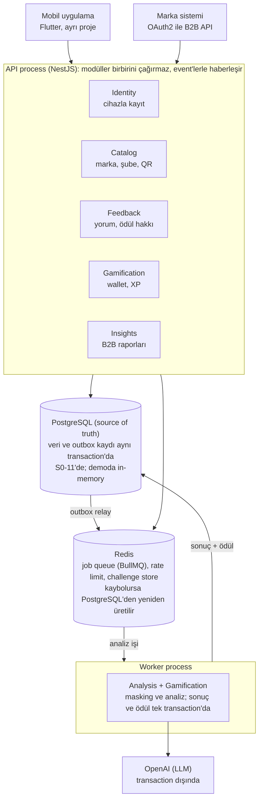
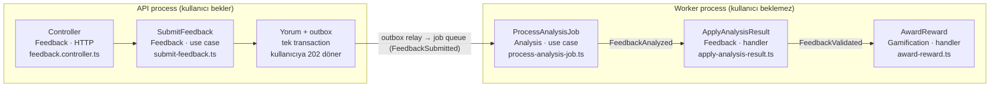

# Neyi Neden Yaptım: Geri Bildirim ve Sadakat Motoru

23 Ekim 2026 · Murat Çay

Bu doküman projede neyi neden böyle yaptığımı, bugün nerede olduğumuzu ve sırada ne olduğunu anlatıyor. Hem proje sahibi hem de projeyi devralacak ekip için yazıldı. İlk dört bölüm herkes için; "Büyük resim" bölümünden sonrası daha çok koda dokunacak ekip için. Projeyi kendi bilgisayarınızda denemek için Demo Rehberi'ne bakın.

## Durum

Backend'in iş kuralları, güvenlik korumaları ve API'si çalışıyor. Eksik olan en önemli parça kalıcı veri: şu an her şey memory'de tutuluyor ve PostgreSQL geçişi yarıda. Production'a çıkmadan önce bu işin bitmesi ve aşağıdaki kararların netleşmesi gerekiyor.

```mermaid
flowchart LR
    subgraph bitti["Bitti (10)"]
        direction TB
        S01["S0-01 Proje iskeleti"]
        S02["S0-02 API contract"]
        S03["S0-03 Shared kernel"]
        S04["S0-04 Catalog"]
        S05["S0-05 Identity"]
        S06["S0-06 Gamification"]
        S07["S0-07 Feedback"]
        S08["S0-08 Analysis"]
        S09["S0-09 Insights"]
        S10["S0-10 Async altyapı"]
    end
    subgraph suruyor["Sürüyor (1)"]
        S11["S0-11 PostgreSQL<br/>ilk parça bitti"]
    end
    subgraph baslamadi["Başlamadı (4)"]
        direction TB
        S12["S0-12 E2E testleri"]
        S13["S0-13 LLM ölçümü"]
        S14["S0-14 Demo verisi"]
        S15["S0-15 Proje sahibi özeti"]
    end
    bitti --> suruyor --> baslamadi
```



Biten her işin otomatik testleri geçiyor ve kodu review edildi.

## Bugün neler çalışıyor

Proje metnindeki beş modülün temel akışları backend'de çalışıyor. Mobil uygulama ve marka paneli henüz olmadığı için onların göndereceği request'ler Postman'den elle gönderilerek denenebiliyor.

- **Formsuz kayıt:** Kullanıcıdan ad, telefon ya da e-posta istenmiyor. Kimlik, telefonun secure chip'indeki key'e bağlı. Kayıtla birlikte kullanıcının wallet'ı da otomatik açılıyor.
- **QR ile yorum ve ödül:** Kullanıcı şubedeki QR'ı okutup yorum yazıyor. Yorum anında kabul ediliyor, LLM analizi arka planda yapılıyor, sonra XP ve puan veriliyor. Level hesabı da hazır.
- **Suistimale karşı kurallar:** Aynı şubeden 24 saatte en fazla bir ödül ve en fazla üç yorum. Aynı request iki kez gelirse ikinci yorum ya da ikinci ödül oluşmuyor. Platform attestation'dan geçemeyen cihaz ve signature'ı tutmayan request ödül alamıyor. Anlamsız yorumlar spam sayılıyor.
- **Kişisel veri masking:** Yorumdaki telefon, e-posta, plaka, T.C. kimlik no, IBAN ve kart numarası LLM'e gitmeden ve markaya gösterilmeden önce maskeleniyor. Yorumun ham hali şifreli saklanıyor.
- **Marka tarafı (B2B API):** Markalar OAuth2 ile token alıp kendi şubelerini, maskelenmiş yorumları, şube özetini, topic listesini ve heatmap verisini çekebiliyor. Bir marka başka bir markanın verisini göremiyor.
- **Teknik korumalar:** Cihaz, marka ve IP başına rate limit; her response'ta takip için bir request id.

### Neler gerçek, neler geçici

İş kuralları ve API production'daki haliyle çalışıyor. Altyapının bir kısmı ise şimdilik geçici. Geçici parçaların her biri bir interface'in arkasında duruyor; gerçeğine geçmek için o interface'in yeni bir implementasyonu yazılıyor, iş kurallarına dokunulmuyor.

- **Veri saklama (geçici):** Şu an memory'de, PostgreSQL geçişi yarıda. Ayrıntısı "Neden database en sona kaldı" bölümünde.
- **Cihaz doğrulaması (geçici):** Development verifier kullanılıyor. Signature'lar gerçek ama Apple ve Google'a sorulmuyor. Production için App Attest ve Play Integrity gerekiyor.
- **LLM analizi (geçici):** OpenAI ya da her yorumu "geçerli, nötr" diye işaretleyen fake analyzer. Model henüz seçilmedi.
- **Şifreleme key'i (geçici):** Şu an local. Production'da AWS KMS kullanılacak.
- **Job queue, rate limit, challenge store (hazır):** Redis versiyonları yazıldı ve test edildi; demoda kolaylık olsun diye in-memory çalışıyorlar.

Mobil uygulama, marka paneli ve AWS kurulumu bu projenin kapsamında değil.

## Proje sahibinin vermesi gereken kararlar

Bu kararlar netleşmeden production'a çıkılamaz. Parantez içindeki kodlar gereksinim dokümanındaki (SRS) karşılıkları; ayrıntı lazım olursa oradan bakılabilir.

### Fişteki QR ve anket: toplantıda konuşulan yeni yön

Toplantıda QR kodunun şubede sabit durmak yerine POS cihazının bastığı fişte yer alması konuşuldu:

- QR fişe basılacak. İçinde bir statik kod, sipariş bilgileri ve vergi kimlik numarası gibi bilgiler olacak.
- Kullanıcı QR'ı okutunca hem yorum ekranı hem de sipariş özetine göre hazırlanmış bir anket açılacak.

Bu, bugünkü tasarımdan farklı: şu an her şubenin tek ve sabit bir QR'ı var ve anket özelliği yok. İyi tarafı, fişe basılan QR'ın daha önce önerilen en güçlü koruma olması; QR'ın fotoğrafının internette paylaşılması sorununu da çözüyor (CR-001). İşe başlamadan önce netleşmesi gerekenler:

- **POS entegrasyonu:** Hangi POS cihazları ya da firmalarıyla çalışılacak? QR'ı POS kendisi mi üretecek, yoksa bizim API'mizden mi alacak?
- **QR'ın içeriği:** Sipariş bilgileri QR'ın içinde mi duracak, yoksa QR sadece bir id taşıyıp detaylar başka bir yerden mi çekilecek? Sipariş bilgisinde kişisel veri varsa KVKK değerlendirmesine dahil edilmeli.
- **Vergi kimlik numarası:** Markanın ya da şubenin mi, müşterinin mi? Müşterininse kişisel veri sayılır.
- **Güvenlik:** Sahte QR üretilememesi için QR'ın imzalı ve süreli olması gerekir. Bir fişle kaç kez yorum yazılabilecek?
- **Ödül kuralları:** Bugünkü "aynı şubeden 24 saatte bir ödül" kuralı fiş başına bir ödüle mi dönüşecek?
- **Anket:** Soruları kim belirleyecek, marka mı platform mu? Anket cevapları ödül kazandıracak mı? Markalar sonuçları B2B API'den mi alacak?

Bu değişiklik QR, yorum, ödül ve B2B taraflarını etkiliyor. SRS'e change request olarak eklenmeli ve ekip bu işe başlamadan netleşmeli.

### En önemli üç karar

1. **KVKK (S-13):** Verinin sorumlusu platform mu, marka mı? Yorumları yurt dışındaki bir LLM sağlayıcısına göndermenin hukuki dayanağı ne; veri işleme sözleşmesi ya da açık rıza gerekiyor mu? Bunu hukuk danışmanınızın netleştirmesi gerekiyor.
2. **LLM bütçesi (S-15):** Bütçe kullanıcı sayısı arttıkça büyüyecek mi, yoksa yorum başına bir maliyet hedefi mi konacak? Ayrıntısı bir sonraki bölümde.
3. **Apple ve Google hesapları (S-17):** Cihaz doğrulaması için App Attest ve Play Integrity kurulmalı. Bunu siz mi yapacaksınız, ekip mi?

### Diğer açık sorular

- **Saklama süresi (S-14):** Maskelenmiş yorumlar 2 yıl sonra silinip sadece toplu istatistik olarak tutulabilir mi?
- **Puan politikası (S-16):** Puanların son kullanma tarihi olacak mı? Hile tespit edilip geri alınan puan bakiyeyi eksiye düşürürse ne yapılacak?
- **Erişilebilirlik (S-18):** %99,5 uptime, en fazla 5 dakikalık veri kaybı ve 4 saatte geri dönüş hedefleri beklentinizle uyumlu mu?
- **Marka entegrasyonu (S-19):** Markaların sistemleri OAuth2 client credentials ile bağlanabilir mi?
- **Veritabanı (S-20):** Kullanmak istediğiniz ya da zorunlu olduğunuz bir veritabanı var mı? Yanıt gelmediği için PostgreSQL ile ilerlendi.
- **Domain ve uygulama linkleri (S-21):** QR'larda hangi domain kullanılacak? Uygulama yüklü değilse kullanıcı App Store ya da Google Play'e mi yönlendirilsin?

### Onaylanması gereken ekip önerileri

SRS'te toplam 21 öneri var; proje metninde net olmayan yerler için yazıldılar. Demoda doğrudan görülenler:

1. "Bugün neler çalışıyor" bölümündeki ödül kuralları, cihaz doğrulaması ve masking. Fişteki QR'a geçilirse ödül kuralları değişecek.
2. XP sıfırlanmaz; level 2 için toplam 100, level 3 için toplam 300 XP gerekir.
3. Markaların kendi panelleri var; platform sadece API sağlar.
4. Puan MVP'de sadece birikir; neye dönüşeceği sonraki fazda belirlenir.

## LLM bütçesi ve model seçimi

Önerilen aylık 300 USD bütçe pilot dönem için rahatça yeter. 12 aylık hedefte ise ancak çok ucuz bir modelle yeter. Model henüz seçilmedi; aday modellerin Türkçe yorumlar üzerinde ölçülmesi sıradaki işler arasında.

- **Pilot (günde 2.000 yorum):** Ayda 60.000 analiz, yaklaşık 42 milyon token. 300 USD ile milyon token başına 7,1 USD'ye kadar bir model kullanılabilir; rahat bir sınır.
- **12 aylık hedef (günde 100.000 yorum):** Ayda 3 milyon analiz, yaklaşık 2,1 milyar token. 300 USD için milyon token başına 0,14 USD gerekir; bu, bugünkü küçük modellerin fiyatının sınırında ya da altında.

Hesaplar yorum başına yaklaşık 700 token varsayımına dayanıyor; pilotta gerçek kullanımla güncellenmeli. Maliyeti düşüren önlemler tasarımda zaten var: sabit system prompt'un sağlayıcı tarafında cache'lenmesi, kısa topic listeleri, spam'in LLM'e gitmeden ayıklanması ve gerekirse daha küçük bir model.

**Proje sahibinden beklenenler:**

- Aylık bütçe tutarı ve bütçe uyarılarının kime gideceği.
- Model ölçümü için bir OpenAI API key'i ve ölçüm setini bağımsız olarak etiketleyecek ikinci bir kişi (sektör başına yaklaşık 50 Türkçe yorum).
- Sağlayıcı seçimi (OpenAI ya da Anthropic). KVKK değerlendirmesi seçilen sağlayıcıyı kapsamalı.

## Nasıl çalıştım

**Önce dokümanlar, sonra kod.** Kod yazılmadan önce gereksinimler (SRS), tasarım (SDD), tehdit modeli, test stratejisi, domain modeli ve kod yazma kuralları yazıldı ve 10 Ekim'de onaylandı. Kod bu dokümanlara bağlı: bir dokümanla çelişen kod yazılmaz, önce doküman değiştirilir.

*Neden:* Proje metni kısaydı ve bazı yerleri belirsizdi (örneğin "aynı QR ile tekrar puan alamasın" kuralının sınırları). Belirsizliği kodda çözmek, her geliştiricinin farklı bir karar vermesi demek. Bu yüzden belirsiz yerler açık soru ya da ekip önerisi olarak yazılıp proje sahibinin onayına bırakıldı.

**Küçük adımlarla.** Her backlog maddesi küçük slice'lara bölündü. Her slice'ta sıra hep aynıydı: kod, `npm run verify` (type check, lint, format, bağımlılık kuralları, contract lint, bütün testler), dokümanlara göre code review, sonra commit. Review'da bulunan eksik bir sonraki maddeye ertelenmedi, aynı maddede kapatıldı. Kritik testlerde kural bilerek bozuldu ve testin bunu yakaladığı kontrol edildi.

**Kurallar kodla korunuyor.** TypeScript strict mode, fonksiyon başına karmaşıklık sınırı ve modüller arası bağımlılıkları denetleyen dependency-cruiser. Bir modül başka bir modülün içine erişmeye kalkarsa build kırılır; kuralın korunması insan dikkatine kalmıyor.

Geliştirmede yapay zekâ destekli bir kodlama aracı (Claude Code) kullandım; her slice ayrıca dokümanlara göre incelendi ve son kararı ben verdim.

## Büyük resim

Sistem tek bir kod tabanından iki process olarak çalışıyor:

- **API:** Mobil uygulamanın ve markaların request'lerini karşılar. Yorumu kaydeder ve hemen cevap verir.
- **Worker:** Yorumları arka planda LLM ile analiz eder ve ödülü yazar.

Kullanıcı LLM'i beklemez; bir yorumun API'den worker'a nasıl geçtiği "Bir yorumun koddaki yolculuğu" bölümünde.

Kod altı modüle (DDD dilinde "context") bölündü. Her modül işin bir parçasından sorumlu:

- **Identity:** Cihazla kayıt, session, access token.
- **Catalog:** Marka, şube, QR kodları ve topic listeleri.
- **Feedback:** Yorumun alınması ve ödül hakkı kuralları (24 saat, 3 deneme).
- **Analysis:** Masking, spam kontrolü ve LLM analizi.
- **Gamification:** Wallet, XP, puan ve level.
- **Insights:** Markaların kullandığı B2B API ve raporlar.

PostgreSQL source of truth; Redis'teki her şey kaybolsa bile database'den yeniden üretilebilir.



## Kodun yapısı: DDD bilmeyenler için

Kod Domain-Driven Design'a (DDD) ve Clean Architecture'a göre düzenlendi. İlk bakışta dosya sayısı kalabalık görünebilir, ama yapı her modülde aynı tekrar ediyor. Bir modülü çözen hepsini çözmüş olur.

### Klasörler

```
src/
  main.api.ts           API'nin başlangıç noktası
  main.worker.ts        Worker'ın başlangıç noktası
  contexts/             Altı modül: identity, catalog, feedback, analysis, gamification, insights
  composition/          NestJS modülleri: hangi interface'e hangi implementasyon verilecek
  platform/             Ortak teknik parçalar: HTTP, queue, rate limit, Redis
  shared-kernel/        Bütün modüllerin kullandığı küçük ortak tipler
```

Her modülün içinde aynı dört klasör var. Feedback modülünden örnek:

```
src/contexts/feedback/
  domain/               İş kuralları. Saf TypeScript; NestJS, database, HTTP bilmez.
    reward-cooldown/    "24 saatte bir ödül, en fazla 3 deneme" kuralı burada
  application/
    use-cases/          Her endpoint ya da job için bir dosya (submit-feedback.ts gibi)
    ports/              Dış dünyadan ihtiyaç duyulan interface'ler (FeedbackRepository gibi)
  adapters/
    inbound/http/       Controller'lar: request'i alıp use case'i çağırır
    outbound/           Interface'lerin implementasyonları (memory repository, şifreleme)
  public/               Diğer modüllerin kullanabileceği tek kapı
```

**Okuma sırası önerisi:** Bir özelliği anlamak için controller'dan başlayın, oradan use case'e, oradan domain'e gidin. Örneğin yorum gönderme için: `feedback.controller.ts` → `submit-feedback.ts` → `reward-cooldown.ts`.

### Terimler

DDD'nin kendi sözlüğü var. Çoğunun alışık olduğunuz bir karşılığı var:

- **Context (bounded context):** Modül. Kendi verisine ve kurallarına sahip bir iş alanı.
- **Use case:** Service katmanındaki bir metot gibi düşünün; ama her biri ayrı bir sınıf ve tek bir iş yapıyor.
- **Port:** Interface. Use case'in dış dünyadan neye ihtiyaç duyduğunu söyler ("yorumu kaydet", "LLM'e sor").
- **Adapter:** O interface'in implementasyonu. Memory repository, PostgreSQL repository, OpenAI client hepsi adapter.
- **Aggregate:** Kendi kurallarını koruyan iş nesnesi. Örneğin `RewardCooldown`, ödül hakkı kuralını tek başına uygular; dışarıdan kural atlatmak mümkün değil.
- **Value object:** Kendini doğrulayan küçük tip. Örneğin `FeedbackText` 20 karakterden kısa olamaz; bu kontrol tek bir yerde.
- **Repository:** Aggregate'i kaydedip okuyan interface.
- **Domain event:** "Şu oldu" mesajı (`UserRegistered`, `FeedbackValidated` gibi). Modüller birbirini doğrudan çağırmaz, bu event'lerle haberleşir.
- **Unit of work:** Bir use case boyunca yapılan bütün kayıtları tek transaction'da toplayan yapı.
- **Composition:** NestJS modülleri. Hangi port'a hangi adapter'ın verileceği burada seçilir (örneğin `LLM_DRIVER=fake` ise fake analyzer).

### Neden bu kadar dosya?

Kısa cevap: kuralları framework'ten ve database'den ayırmak için. Bunun üç somut faydası var:

- **Hızlı ve güvenilir testler:** Ödül, level ve masking kuralları database ya da Redis açmadan, milisaniyeler içinde test ediliyor.
- **Kolay değişim:** Memory'den PostgreSQL'e, fake analyzer'dan OpenAI'a geçmek için sadece yeni bir adapter yazılıyor; iş kurallarına dokunulmuyor. Şu anki PostgreSQL geçişi tam olarak bu.
- **Modüller birbirini bozmaz:** Bir modül başka bir modülün sadece `public/` klasörünü kullanabilir.

## Bir yorumun koddaki yolculuğu

Kodu anlamanın en kolay yolu tek bir özelliği baştan sona izlemek. Yorum gönderme hemen her modüle dokunduğu için iyi bir örnek.



LLM çağrısı transaction dışında yapılır; analiz sonucu ve ödül ise tek transaction'da birlikte yazılır.

**API process'te (kullanıcı bekler):**

1. **Controller** (`contexts/feedback/adapters/inbound/http/feedback.controller.ts`): Request'i alır, token'dan kullanıcıyı bulur, body'yi Zod ile kontrol eder ve use case'i çağırır. İş kuralı yok; sadece HTTP ile use case arasında çeviri yapar.
2. **SubmitFeedback** (`contexts/feedback/application/use-cases/submit-feedback.ts`): Asıl işin yapıldığı yer. Sırasıyla: metnin uzunluğunu kontrol eder (`FeedbackText`), QR'ı Catalog modülüne çözdürür (`catalog/public/qr-resolver.ts`), signature'ı Identity modülüne doğrulatır (`identity/public/platform-proof-verifier.ts`), ham metni şifreler ve ödül kuralını `RewardCooldown`'a sorar.
3. **Kayıt:** Yorum, güncellenmiş `RewardCooldown` ve `FeedbackSubmitted` event'i tek transaction'da yazılır. Bu event outbox'a gider (`composition/event-routes.ts`'te böyle tanımlı). Kullanıcıya `202` döner.

**Worker process'te (kullanıcı beklemez):**

4. **ProcessAnalysisJob** (`contexts/analysis/application/use-cases/process-analysis-job.ts`): Outbox relay'in queue'ya koyduğu işi alır. Önce spam kontrolü (`pre-checks.ts`), sonra masking (`pii-masker.ts`), sonra LLM'e gönderir (`SentimentAnalyzer` interface'i; arkasında OpenAI ya da fake analyzer). Sonuç `FeedbackAnalyzed` event'i olarak yayılır.
5. **ApplyAnalysisResult** (`contexts/feedback/application/use-cases/apply-analysis-result.ts`): Sonucu yoruma işler. Yorum geçerliyse ve ödüle uygunsa `FeedbackValidated` event'ini yayar ve 24 saatlik bekleme süresini başlatır.
6. **AwardReward** (`contexts/gamification/application/use-cases/award-reward.ts`): Wallet'a XP ve puan ekler.

Mobil uygulama bu sırada `GET /v1/feedbacks/{id}` ile yorumun durumunu sorgular (`get-feedback-status.ts`).

Kayıt akışı da aynı mantıkla çalışır: Identity'deki `register-device.ts` kullanıcıyı oluşturup `UserRegistered` event'ini yayar, Gamification'daki `open-wallet.ts` bu event'i dinleyip wallet'ı açar. Hangi event'i kimin dinlediği tek bir dosyada: `src/composition/event-routes.ts`.

## Temel kararlar ve nedenleri

En çok şeyi belirleyen karar şu: ödül kuralları kodun içinde, test edilebilir tek bir yerde duruyor ve database, queue ya da LLM sağlayıcısı değişse de etkilenmiyor. Aşağıdaki kararların çoğu bunun sonucu. Elenen alternatiflerle birlikte tam liste SDD Bölüm 5'te (ADR-001'den ADR-022'ye).

1. **Modular monolith (ADR-001).** Tek kod tabanı; API ve worker aynı koddan iki process. *Neden:* Ölçek ve ekip büyüklüğü microservice gerektirmiyor. Modüller ayrı tutulduğu için ileride bölünebilir.
2. **Analiz arka planda (ADR-002).** Yorum hemen kabul ediliyor, analiz queue'dan yapılıyor. *Neden:* LLM'in yavaşlığı ya da çökmesi kullanıcıya yansımamalı.
3. **Transactional outbox (ADR-005, ADR-009).** Yorum ve "analiz edilecek" kaydı aynı transaction'da yazılıyor. *Neden:* Queue çökse bile hiçbir yorum kaybolmuyor.
4. **Önce API contract (ADR-006).** `openapi.yaml` elle yazıldı; API'nin response'ları testlerde ona göre kontrol ediliyor. *Neden:* Mobil ekip backend'i beklemeden çalışabilsin ve iki taraf birbirinden kopmasın.
5. **Node.js, TypeScript ve NestJS (ADR-007, ADR-008).** *Neden:* Ekip en hızlı bu dilde çalışıyordu ve NestJS'in modül yapısı modular monolith'e uyuyor. Bakımı üstlenecek ekip başka bir dilde uzmansa bu karar yeniden değerlendirilebilir (K-9).
6. **Cihaza bağlı kimlik (ADR-012).** Telefonun secure chip'indeki key Apple ve Google tarafından doğrulanıyor; ödül getiren her request imzalı. *Neden:* Sadece cihaz id'sine güvenilseydi bir script sınırsız hesap açıp puan toplayabilirdi.
7. **B2B için OAuth2 (ADR-013).** Client credentials, 15 dakikalık token, scope. *Neden:* Kurumsal sistemlerin tanıdığı standart; secret değiştirmek kesinti gerektirmiyor.
8. **Analiz sonucu ve ödül tek transaction'da (ADR-014).** LLM çağrısı transaction dışında; sonucu ve ödül birlikte yazılıyor. *Neden:* "Geçerli ama ödülsüz" ya da "ödüllü ama geçersiz" gibi yarım bir durum oluşmasın.
9. **İki tür limit (ADR-016).** Ödül kuralları database'de ve kesin; teknik rate limit Redis'te. *Neden:* Puanı etkileyen kural kalıcı olmalı, bot koruması ise hızlı ve ucuz.
10. **Database en son (ADR-017).** Ayrıntısı bir sonraki bölümde.
11. **Kurallar aggregate'lerde (ADR-019).** Ödül hakkı kuralı `RewardCooldown` nesnesinin içinde; eşzamanlılık optimistic locking ile korunuyor. *Neden:* Kural tek yerde duruyor ve aynı anda gelen 20 request yine tek ödül üretiyor.
12. **ORM yok (ADR-022).** `pg` driver'ı ve elle yazılmış SQL. *Neden:* Kurallar kodda olduğu için database katmanı ince; constraint hatalarını doğru error code'larına çevirmek ve partial index'ler zaten ham SQL istiyor.

## Neden database en sona kaldı

Bugün verilerin memory'de durması bir gecikme değil, planlanmış bir sıra (ADR-017).

- **İş kuralları önce doğru olmalıydı.** Ödül hakkı, level ve masking kuralları database olmadan, milisaniyeler içinde çalışan testlerle yazıldı. Database en başta olsaydı kuralların bir kısmı SQL sorgularına dağılırdı.
- **Database kararı proje sahibine bağlıydı.** Tercih edilen bir database olup olmadığı sorusu (S-20) cevapsız kaldı. Kararı sona bırakmak, PostgreSQL dışında bir şey seçilse bile iş kodunun değişmemesini sağladı.
- **Aynı testler iki kez çalışacak.** Her repository için bir contract test paketi yazıldı. Bu paket bugün memory repository'lere karşı geçiyor; PostgreSQL repository'leri yazıldığında aynı paket gerçek database'e karşı çalışacak. Davranışın değişmediği böyle kanıtlanıyor.

**Bedeli:** Demo veriyi kalıcı saklamıyor ve çift ödül koruması henüz gerçek database'de kanıtlanmadı. Memory'de request'ler tek tek işlendiği için gerçek bir yarış (race condition) oluşmuyor; gerçek yarış ancak PostgreSQL'de görülür. Bu yüzden sprint planlamasında PostgreSQL geçişi "hiçbir koşulda ertelenmez" olarak işaretlendi.

**Şu anki durum:** PostgreSQL geçişinin ilk parçası bitti: transaction yönetimi, outbox, optimistic locking yardımcısı ve migration runner. Kalan iş, her repository'nin PostgreSQL versiyonunu bu altyapının üzerine yazmak.

## Bilerek yapılmayanlar ve bilinen sorunlar

### Bilinen sorunlar

- **Küçük harfli plakalar maskelenmiyor.** `34 ABC 123` maskeleniyor, `34 abc 123` maskelenmiyor. Sebebi `src/contexts/analysis/domain/masking/pii-masker.ts` dosyasındaki plaka regex'inin sadece büyük harfleri yakalaması. Çözümü: regex'e `i` flag'ini eklemek ve teste küçük harfli örnekler koymak. Kullanıcılar çoğunlukla küçük harfle yazacağı için öncelikli.
- **`demo` branch'indeki eksikler:** README'deki demo başlatma bölümü güncel değil; simülatör bütün network interface'lerini dinliyor (`scripts/demo-sim/server.ts`'te `127.0.0.1`'e bağlanmalı); `npm run verify` bu branch için çalıştırılmadı. Main'e almadan önce kapatılmalı.
- **`S0-11` branch'indeki doküman eksiği:** `ARCHITECTURE.md` PostgreSQL katmanını henüz göstermiyor (`platform/postgres/`, `db/migrations/`). S0-11 kapanırken eklenmeli.

### Bilerek yapılmayanlar

- **LLM bütçe koruması:** Token sayıları kaydediliyor, ama para cinsinden maliyet ve limit yok. *Neden:* Model seçilmeden fiyat belli değil.
- **Anthropic adapter'ı:** Sadece OpenAI var. *Neden:* Öncelik sırasında "Should" seviyesindeydi.
- **İsim masking:** İsimler maskelenmiyor; "Kasadaki Mehmet Bey" gibi isimler markaya ulaşabiliyor. *Neden:* Türkçe isim tanıma (NER) sonraki faza bırakıldı.
- **Veri silme talebi, saklama süresi, ödülün geri alınması, cihaz engelleme:** Yapılmadı. *Neden:* MVP kapsamında ama demo sonrasına planlandı.
- **B2B tarih aralığı üst sınırı:** Sınır yok. *Neden:* Demo için benim kararım; proje sahibine sorulmalı.
- **Redis çökerse rate limit:** Request'ler geçer (fail open) ve bir uyarı loglanır. *Neden:* Bot koruması yüzünden gerçek kullanıcı engellenmesin; ikinci savunma hattı WAF.
- **Redis çökerse challenge store:** Request reddedilir (500). *Neden:* Saklanamayan bir challenge sonra doğrulanamaz; burada fail open güvensiz olur.

## Devralacak ekip için

### Repo ve branch'ler

Kod ve bütün dokümanlar [GitHub repo'sunda](https://github.com/dev-murchi/gemified-feedback-loyalty-project-demo). Üç branch var:

- **`main`:** S0-10'a kadar biten işler.
- **`S0-11`:** PostgreSQL geçişinin ilk parçası ve güncellenmiş tasarım dokümanları (SDD v1.5). Main hâlâ SDD v1.4'te.
- **`demo`:** Telefon simülatörü ve `npm run start:demo`. Demo Rehberi bu branch'i kullanır.

`S0-11` ve `demo` aynı commit'ten ayrılıyor ve birbiriyle çakışmıyor; tek ortak dosya `package.json` ve değişiklikler farklı yerlerde.

### İlk gün ne okunmalı

Koda geçmeden önce bu sırayla okumanızı öneririm:

1. **Bu doküman ve Demo Rehberi:** Sistem ne yapıyor, nasıl çalıştırılıyor.
2. **`CLAUDE.md`:** Kurallar, versiyonlar, şu anki durum ve sıradaki iş.
3. **`docs/08-sprint-0-backlog.md`:** Backlog maddeleri ve her birinin ne zaman "bitti" sayılacağı.
4. **`docs/07-muhendislik-standartlari.md`:** Klasör yapısı, katman kuralları ve code review kontrol listesi (§11).
5. **`ARCHITECTURE.md`:** Kodun haritası ve bilinen eksikler.
6. **SDD Bölüm 5 (ADR'ler) ve 6 (veri modeli):** Bir kararı değiştirmeden önce gerekçesini okuyun.

Diğer dokümanlar: gereksinimler `docs/01-gereksinim-dokumani-SRS.md`, tehdit modeli `docs/03`, test stratejisi `docs/04`, domain modeli `docs/06`, API contract `docs/api/openapi.yaml`.

### Çalıştırma

Node 22 (`nvm use`). Her değişiklikten sonra `npm run verify` çalıştırın. Integration testleri Redis ve PostgreSQL'i Testcontainers ile açtığı için Docker gerekiyor. Sadece demo için Docker gerekmez.

### Kurallar

- **Dokümanlar bağlayıcı.** Bir kurala uymayan bir çözüm gerekiyorsa kodu yazmadan önce dokümanı değiştirin ve gerekçesini yazın.
- **Ürün kuralları proje sahibinindir.** Ekip önerileri "proje sahibinin onayını bekliyor" olarak işaretli; tek başınıza değiştirmeyin.
- **Bir seferde bir slice.** Review'da bulunan eksik o maddede kapanır, sonrakine ertelenmez.

### Sıradaki işler

1. **PostgreSQL geçişini bitirmek (S0-11):** SDD 6.1'e göre kalan tabloların migration'ları, altı modülün repository'leri, raporlama sorguları, aynı anda gelen request'lerde tek ödül verildiğinin gerçek database'de test edilmesi (TC-QR-01) ve API ile worker ayrı process'lerdeyken e2e test. Adı belirlenmiş iki unique constraint dışında hiçbir `unique_violation` çakışma hatasına çevrilmez (docs/07 Bölüm 6).
2. **Bilinen sorunları kapatmak:** "Bilinen sorunlar" listesindekiler.
3. **Fişteki QR ve anket kararı:** Proje sahibiyle netleştirip SRS'e change request olarak eklemek.
4. **Testleri tamamlamak (S0-12):** Kullanıcı hikayeleri için e2e testleri ve API'nin contract ile birebir karşılaştırılması.
5. **Model seçimi (S0-13):** Ölçüm seti, aday modellerin ölçülmesi ve model kararı.
6. **Gerçekçi demo verisi (S0-14):** Yaklaşık 100 gerçekçi Türkçe yorum.
7. **Demo sonrası, MVP'ye kadar:** "Bilerek yapılmayanlar" listesindeki işler, gerçek App Attest ve Play Integrity, AWS kurulumu.
